# Modern .NET — Complete End-to-End Architecture and Execution Flow

## Scope

This document covers the .NET architecture and execution concepts studied up to the pre-GC portion of the learning series.

**Included:**
- C# source processing and the Roslyn compiler pipeline
- IL, metadata, assemblies, and PE files
- Windows process creation and .NET application startup
- .NET hosting, `hostfxr`, `hostpolicy`, and CoreCLR initialization
- Assembly loading, runtime type information, and JIT compilation
- IL execution model, native machine instructions, CPU execution, registers, caches, and RAM
- CoreCLR runtime subsystems
- Async/await state machines, `Task`, continuations, ThreadPool, and asynchronous I/O
- ASP.NET Core request execution, middleware, dependency injection, and high-concurrency processing

**Excluded:** Detailed GC internals, generations, allocation paths, marking, compaction, LOH, POH, and GC tuning, because those architectural diagrams are maintained separately.

---

# 1. Complete End-to-End Architecture: C# Source to CPU Execution

This is the master diagram connecting the compiler, operating system, .NET host, runtime, JIT, and processor.

```mermaid
flowchart TD
    A["Developer writes C# source code"] --> B["Source files: .cs"]
    B --> C["Roslyn C# compiler"]

    C --> D["Lexical analysis"]
    D --> E["Tokens"]
    E --> F["Parsing"]
    F --> G["Syntax tree"]
    G --> H["Semantic analysis"]
    H --> I["Bound representation"]
    I --> J["Lowering and compiler transformations"]
    J --> K["IL and metadata generation"]
    K --> L["PE/COFF output"]

    L --> M[".NET assembly: DLL or EXE"]
    M --> N["Deployment artifacts and runtime configuration"]

    N --> O["Application launch"]
    O --> P["Windows process creation"]
    P --> Q["Windows image loader"]
    Q --> R["Native application entry point / .NET hosting entry"]
    R --> S[".NET host initialization"]

    S --> T["hostfxr"]
    T --> U["Runtime and framework resolution"]
    U --> V["hostpolicy"]
    V --> W["CoreCLR runtime initialization"]

    W --> X["Assembly loading and dependency resolution"]
    X --> Y["Metadata inspection and type loading"]
    Y --> Z["Method execution requested"]

    Z --> AA["JIT compilation, when required"]
    AA --> AB["Native machine code"]
    AB --> AC["CPU instruction execution"]

    AC --> AD["Results, side effects, I/O, and further method calls"]
    AD --> AE["Application continues running"]

    classDef compile fill:#dceafe,stroke:#356ac3,color:#111
    classDef host fill:#fff0cc,stroke:#b07b00,color:#111
    classDef runtime fill:#dff5e1,stroke:#36834a,color:#111
    classDef cpu fill:#f4ddf7,stroke:#8e44ad,color:#111

    class A,B,C,D,E,F,G,H,I,J,K,L,M,N compile
    class O,P,Q,R,S,T,U,V host
    class W,X,Y,Z,AA,AB runtime
    class AC,AD,AE cpu
```

## 1.1 The six major execution stages

| Stage | Responsible component | Main output |
|---|---|---|
| 1. Compilation | Roslyn compiler | IL, metadata, PE assembly |
| 2. Process startup | Windows and application entry point | Process and initial execution environment |
| 3. Runtime hosting | .NET host components | Selected runtime loaded and initialized |
| 4. Runtime loading | CoreCLR loader and type system | Loaded assemblies, types, and method information |
| 5. Code generation | JIT compiler, when applicable | Native machine code |
| 6. Execution | CPU and operating system | Application instructions and observable behavior |

**Important:** Compilation is not the same as execution. Roslyn normally compiles C# into IL rather than directly into the final CPU instructions for each method. The JIT translates IL into native code at runtime when that method needs execution, unless an alternative such as Native AOT or ReadyToRun changes the path.

---

# 2. Roslyn Compiler Architecture: Characters to Assembly

Roslyn is the .NET compiler platform. The C# compiler transforms source text into an executable representation and emits the relevant metadata.

## 2.1 Complete Roslyn compilation flow

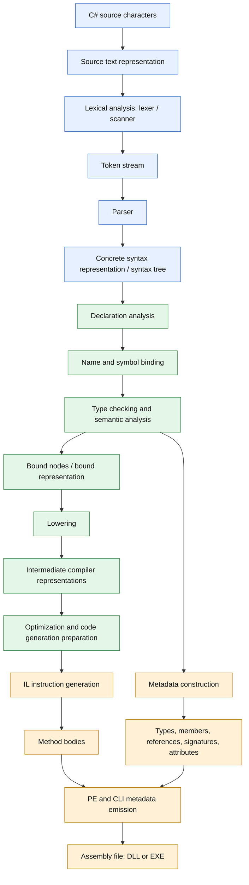

This diagram is a conceptual pipeline. Roslyn has more internal stages, and some activities are interleaved rather than being strictly isolated into one linear pass.

## 2.2 Stage 1 — Source characters and lexical analysis

The compiler begins with source text.

Example:

```csharp
int total = price + tax;
```

The lexer groups characters into tokens. It recognizes language elements such as keywords, identifiers, operators, literals, and punctuation.

Conceptually:

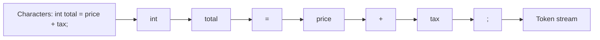

| Source element | Token category |
|---|---|
| `int` | Keyword |
| `total` | Identifier |
| `=` | Assignment operator |
| `price` | Identifier |
| `+` | Addition operator |
| `tax` | Identifier |
| `;` | Punctuation / statement terminator |

The lexer identifies tokens. It does not, by itself, determine whether `price` is a declared variable of a valid type.

**Architectural distinction:** Lexical analysis determines what the source elements are; semantic analysis determines what those elements mean in the program.

## 2.3 Stage 2 — Parsing and syntax tree construction

The parser consumes tokens and checks whether their arrangement follows the C# grammar.

For example:

```csharp
int total = price + tax;
```

A simplified syntax tree could be represented as:

```text
LocalDeclarationStatement
└── VariableDeclaration
    ├── PredefinedType: int
    └── VariableDeclarator: total
        └── EqualsValueClause
            └── AddExpression
                ├── IdentifierName: price
                └── IdentifierName: tax
```

A syntax tree captures the grammatical structure of the source, including constructs that may later produce compiler errors.

If the source is malformed, Roslyn can still construct a syntax tree containing missing or unexpected syntax nodes. This supports IDE features such as diagnostics, IntelliSense, and live editing.

## 2.4 Stage 3 — Declaration analysis and semantic analysis

The compiler must determine the meaning of identifiers and expressions.

Consider:

```csharp
int price = 100;
int tax = 10;
int total = price + tax;
```

Semantic analysis establishes:

- `price` refers to a particular declared local variable.
- `tax` refers to another local variable.
- Both operands are compatible with the addition operation.
- The expression's result is compatible with `int`.
- The declaration of `total` is valid.

Conceptually:

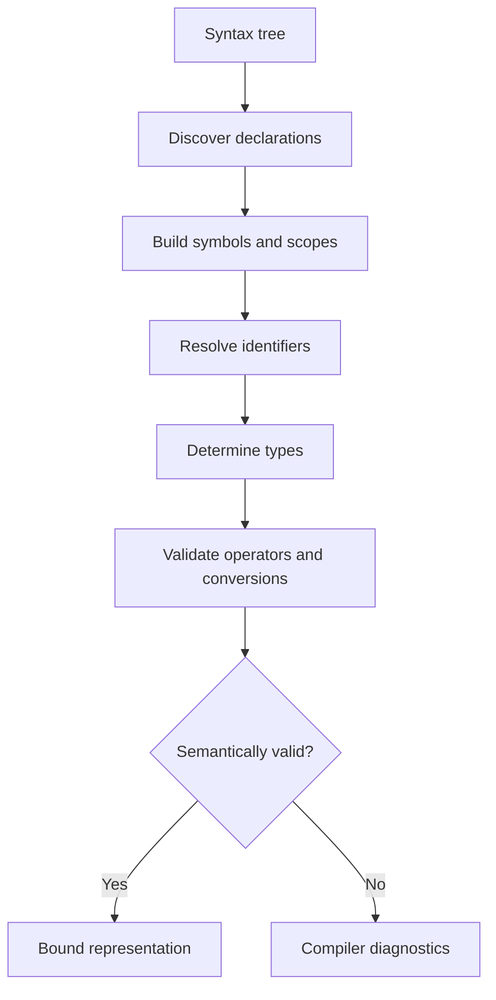

### What is a symbol?

A symbol represents a declared program entity, such as a type, method, property, field, parameter, or local variable.

Symbols help the compiler answer questions such as:

- Which method does this call refer to?
- Which overload should be selected?
- What type does this expression have?
- Is a conversion legal?
- Is the member accessible here?

### What is a bound tree?

The bound representation records semantic decisions made by the compiler. It connects syntax to the symbols, types, conversions, and operations the compiler has resolved.

A syntax node might simply represent the text `price + tax`. The bound representation records the selected operator and the types of the operands and result.

The exact internal representations and pass boundaries are implementation details of Roslyn and can change between compiler versions.

## 2.5 Stage 4 — Lowering and IL generation

High-level C# constructs do not necessarily map directly to single IL instructions.

The compiler transforms constructs into simpler intermediate forms that are easier to emit as IL.

Examples include:

- `foreach` translated into iteration and enumerator operations
- `using` translated into resource cleanup with appropriate exception-handling semantics
- `async` methods transformed into state-machine-related machinery
- Pattern matching translated into tests, branches, and supporting operations
- High-level expressions translated into stack-oriented IL instructions

Conceptual flow:

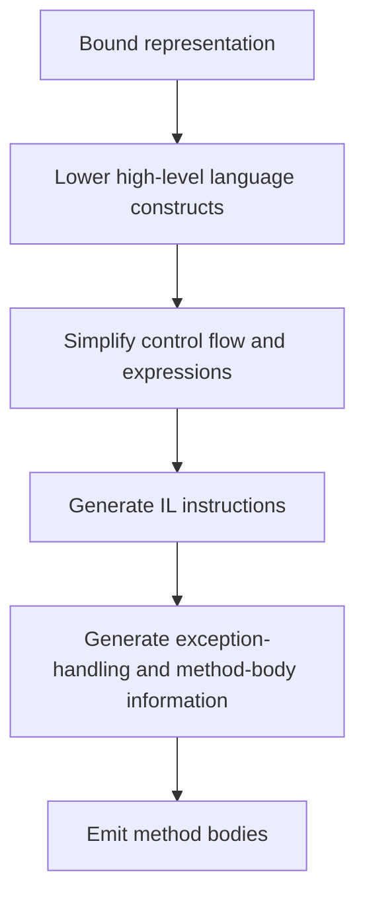

Lowering is not synonymous with all optimization. Compiler transformations, IL generation, and runtime JIT optimization are separate but related stages.

## 2.6 Stage 5 — Metadata generation

IL contains instructions; metadata describes the program structures those instructions refer to.

Conceptual metadata includes:

- Assembly identity and references
- Type definitions and inheritance
- Method and field definitions
- Method signatures and parameter information
- References to external types and members
- Custom attributes
- Generic parameter information
- Exception-handling and related method-body structures

For example, an IL instruction may invoke a method by referring to a metadata token. The runtime resolves that reference to the appropriate method information and implementation.

## 2.7 Stage 6 — PE file and assembly emission

Roslyn emits the compiler output in a PE (Portable Executable) file using the relevant CLI/.NET assembly structures.

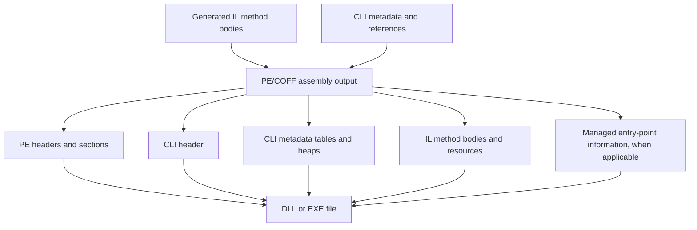

A .NET assembly is not simply a file containing IL. It is a structured binary containing the relevant headers, CLI metadata, IL method bodies and potentially resources and other data.

A DLL and an EXE can both be managed assemblies. A managed EXE may have a native startup stub that transfers control to the .NET hosting/runtime startup path. Exact layouts vary by deployment type and build configuration.

---

# 3. What Is Inside a .NET Assembly?

A managed assembly is a deployment and metadata unit. It provides information needed to identify, load, verify, and execute managed code.

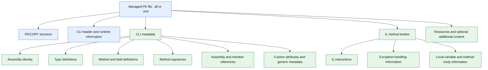

## 3.1 Example: C# method to IL

C#:

```csharp
public static int Add(int a, int b)
{
    return a + b;
}
```

A simplified IL representation may look like:

```il
.method public hidebysig static int32 Add(int32 a, int32 b) cil managed
{
    ldarg.0
    ldarg.1
    add
    ret
}
```

Interpretation:

| IL instruction | Meaning |
|---|---|
| `ldarg.0` | Load the first argument onto the evaluation stack |
| `ldarg.1` | Load the second argument onto the evaluation stack |
| `add` | Add the top two stack values |
| `ret` | Return the result |

This illustrates the **IL evaluation stack**, not the CPU's physical register stack. The JIT can translate the method into native instructions that use registers and machine-level stack locations differently.

The actual IL can differ due to compiler version, build configuration, checked arithmetic, debug settings, and other factors.

---

# 4. Application Launch: Windows Explorer to the .NET Host

When a user double-clicks an application, the launch path crosses the Windows process model and the .NET hosting layer.

The exact path depends on whether the application is framework-dependent, self-contained, single-file, Native AOT, or otherwise customized.

## 4.1 Windows process startup and .NET startup

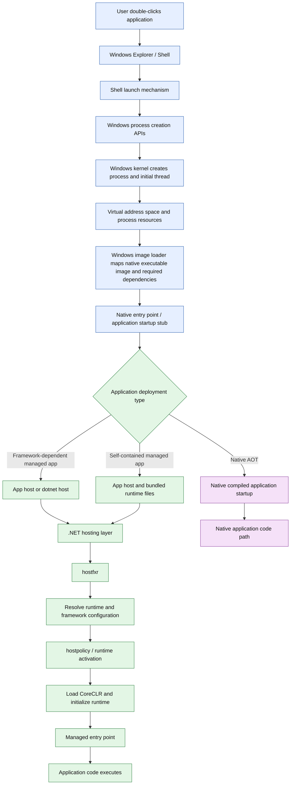

## 4.2 Windows process creation

The Windows shell initiates the launch. Depending on the application and launch mechanism, Windows process-creation APIs such as `CreateProcess` are involved.

Conceptually, Windows then establishes the process execution environment:

1. Creates the process object and initial thread.
2. Establishes the process virtual address space.
3. Maps the executable image and required native modules.
4. Sets up process and thread execution state.
5. Transfers execution to the relevant native startup path.

The Windows loader does not directly compile C# source code or JIT-compile IL. Its role is part of loading and starting the native process image.

**Important distinction:** The process is an operating-system abstraction. The .NET runtime is a managed execution environment initialized within the process.

## 4.3 .NET hosting components

The .NET host determines which runtime environment to activate and coordinates runtime startup.

### `hostfxr`

`hostfxr` is the .NET host resolver. Its responsibilities include resolving the appropriate runtime and framework configuration and coordinating runtime activation.

### `hostpolicy`

`hostpolicy` participates in application policy and runtime activation, including application dependency information and related startup decisions. The exact division of responsibilities depends on the host path and .NET version.

### CoreCLR

CoreCLR is the managed runtime implementation used by the normal CoreCLR-based .NET execution path. It initializes runtime services and enables managed assembly loading, type handling, JIT compilation, execution, threading, exception handling, and other runtime facilities.

These components are not necessarily invoked through an identical sequence for every deployment type. Single-file deployments, self-contained apps, custom hosts, Native AOT, and other configurations may use different startup paths.

## 4.4 Runtime configuration and dependency resolution

A framework-dependent application generally relies on an installed compatible .NET runtime. A self-contained application carries the runtime files needed for its deployment.

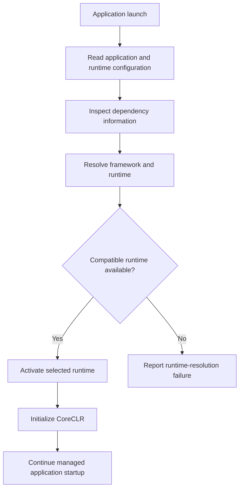

The application’s runtime configuration, framework references, roll-forward policy, installed runtimes, and deployment packaging influence runtime resolution.

---

# 5. CoreCLR Initialization and Runtime Architecture

CoreCLR is much more than a JIT compiler. It coordinates the services required to execute managed code safely and efficiently.

## 5.1 CoreCLR initialization flow

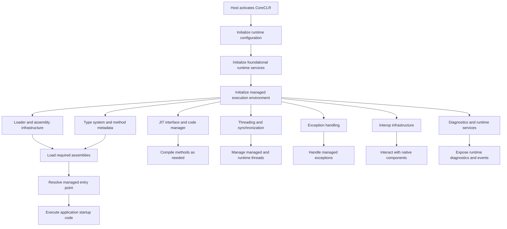

The exact initialization order is implementation-dependent. The diagram represents logical relationships, not a guaranteed call-by-call trace of CoreCLR source code.

## 5.2 CoreCLR subsystem map

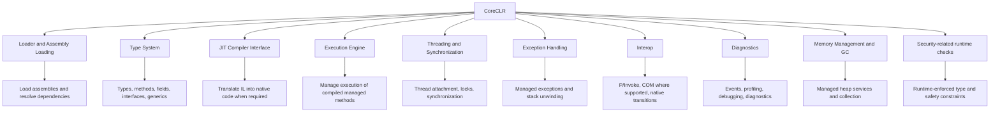

GC appears in this subsystem map only as a component. Its internal architecture and algorithms are intentionally outside the scope of this document.

## 5.3 CoreCLR versus related .NET components

| Component | Primary responsibility |
|---|---|
| Roslyn | Compiles C# and related source languages into compiler output |
| CoreCLR | Managed runtime execution environment |
| JIT | Converts IL method bodies into native code when compilation is needed |
| .NET libraries | Provide APIs for collections, networking, files, tasks, and many other services |
| SDK and CLI | Build, restore, publish, test, and manage .NET applications |
| `hostfxr` | Resolves runtime/framework configuration and coordinates runtime activation |
| `hostpolicy` | Supports application policy and runtime activation |
| Windows loader | Loads native process images and dependencies as part of process startup |

---

# 6. Assembly Loading, Metadata, and Type Loading

The assembly loader and type system establish the runtime representation of managed code.

## 6.1 Assembly-loading flow

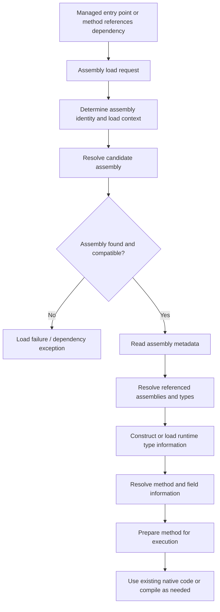

The runtime can load assemblies and types lazily. A process does not necessarily load and JIT-compile every method in every referenced assembly at startup.

## 6.2 Metadata versus runtime objects

Metadata describes types and members in the assembly. Runtime structures represent those types and methods in the executing process.

For example, a class declaration in metadata can describe:

- The type name and namespace
- Its base type and implemented interfaces
- Its methods and fields
- Method signatures and attributes

When the runtime loads the type, it establishes runtime representations needed for type checking, method dispatch, field access, generic handling, and execution.

Conceptual flow:

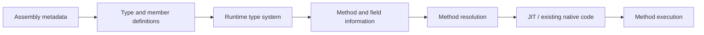

---

# 7. JIT Compilation: IL to Native Machine Code

The JIT compiler converts a method’s IL into native machine instructions for the current execution environment.

## 7.1 Method execution and JIT flow

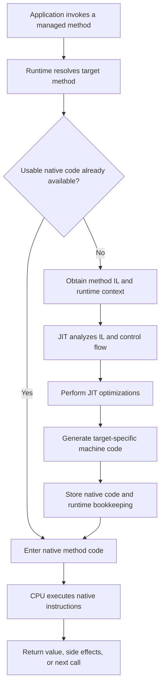

This is a conceptual view. The runtime can use prestored native code, tiered compilation, dynamic code generation, or other execution strategies, depending on the build and runtime configuration.

## 7.2 What the JIT does

The JIT generally must:

1. Interpret the IL and method metadata.
2. Resolve types, calls, and runtime-specific information.
3. Build internal representations for control flow and operations.
4. Perform applicable optimizations.
5. Generate machine instructions for the target architecture.
6. Produce supporting information used by the runtime, such as mappings needed for debugging, exceptions, and managed stack walking.

Potential optimizations include inlining, constant propagation, dead-code elimination, and other transformations. Which optimizations apply depends on the code, runtime version, compilation tier, and execution context.

## 7.3 IL versus native machine code

| Aspect | IL | Native machine code |
|---|---|---|
| Purpose | Portable managed instruction representation | Instructions for a particular processor architecture |
| Produced by | Roslyn or another CLI-compatible compiler | JIT or ahead-of-time compiler |
| CPU executes directly? | No, not in the ordinary CoreCLR JIT path | Yes |
| Platform dependence | Designed to be portable across compatible CLI runtimes | Specific to the target architecture and execution environment |
| Type and method information | Associated with CLI metadata | Supported by runtime structures and generated code |
| Optimization | Compiler transformations can happen before emission | JIT/AOT compiler can apply target-specific optimizations |

The JIT does not simply translate each IL instruction one-for-one. A method’s native code may use different instruction sequences, registers, branches, and memory operations.

---

# 8. IL Execution Model: Evaluation Stack to Native Instructions

The CLI defines an abstract execution model for IL. It includes an evaluation stack, local variables, arguments, method calls, branches, and exception handling.

The CPU does not execute the CLI evaluation stack model directly. The JIT maps the abstract operations to the native execution model.

## 8.1 Conceptual IL execution flow

Example:

```csharp
int Add(int a, int b)
{
    return a + b;
}
```

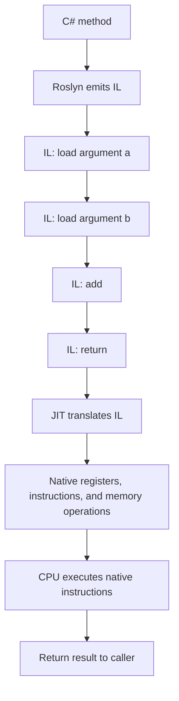

## 8.2 Conceptual evaluation stack

After `ldarg.0` and `ldarg.1`, the abstract evaluation stack contains the two operand values.

After `add`, the stack contains the result.

After `ret`, control returns to the caller with the return value.

```text
Before instructions:
    Evaluation stack: []

After ldarg.0:
    Evaluation stack: [a]

After ldarg.1:
    Evaluation stack: [a, b]

After add:
    Evaluation stack: [a + b]

After ret:
    Return result: a + b
```

This is a conceptual explanation of IL semantics. The JIT may keep the values in CPU registers and never materialize a physical stack corresponding one-to-one with this evaluation stack.

## 8.3 Why IL is useful

IL separates the language compiler from the final processor architecture.

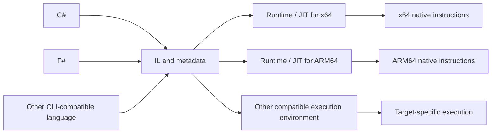

The benefit is that language compilers can target the CLI representation while the runtime handles target-specific execution and optimization.

---

# 9. CPU Execution: Fetch, Decode, Execute

Once the JIT has produced native instructions, the processor executes them using its own instruction architecture and microarchitecture.

## 9.1 Conceptual CPU instruction cycle

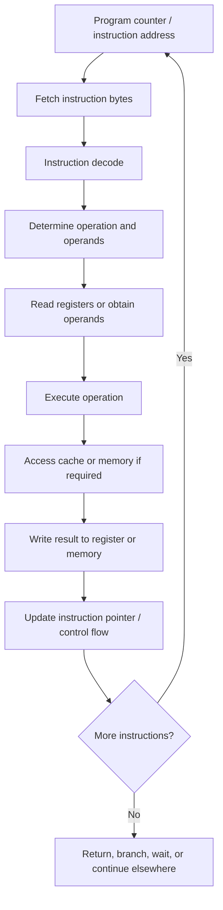

Modern processors use pipelining, out-of-order execution, speculative execution, branch prediction, and multiple execution units. Therefore, fetch/decode/execute is a useful conceptual model, not a literal description of every instruction's timing.

## 9.2 Registers, caches, and RAM

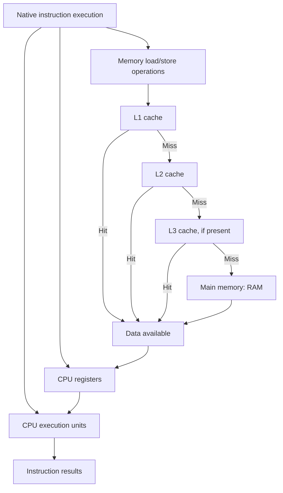

This diagram simplifies real hardware behavior. Cache hierarchies, inclusivity, sharing, coherence, and memory-controller behavior differ by CPU architecture.

### CPU components

- **Registers:** Very fast storage used by instructions for operands, addresses, and intermediate results.
- **Program counter / instruction pointer:** Identifies the current or next instruction location according to the architecture's execution semantics.
- **Execution units:** Perform integer arithmetic, floating-point operations, vector operations, and other work.
- **L1 cache:** Typically the closest cache to a CPU core, often split into instruction and data caches.
- **L2 cache:** A larger cache, often private to a core, depending on the processor.
- **L3 cache:** Often a larger cache shared across some or all cores, where available.
- **RAM:** Main system memory backing process virtual memory and other operating-system allocations.

A cache hit can reduce access latency compared with fetching data from RAM. However, not every instruction needs data from RAM, and the CPU can execute instructions while some memory operations are pending.

## 9.3 The role of the operating system

The operating system and CPU cooperate to run the application.

- Windows schedules threads onto logical processors.
- The CPU executes the thread's native instructions when it is scheduled.
- Memory-management hardware and the OS cooperate to translate virtual addresses and enforce memory protection.
- Interrupts, exceptions, system calls, and context switches can change the execution path.
- When a thread waits for I/O or synchronization, it may stop consuming CPU until it can make progress.

The CPU does not understand C#, .NET classes, `Task`, or ASP.NET Core. Those abstractions are implemented by compilers, runtime code, libraries, and the operating system.

---

# 10. Managed Execution: Runtime, JIT, and OS Interaction

The following diagram combines the major layers at runtime.

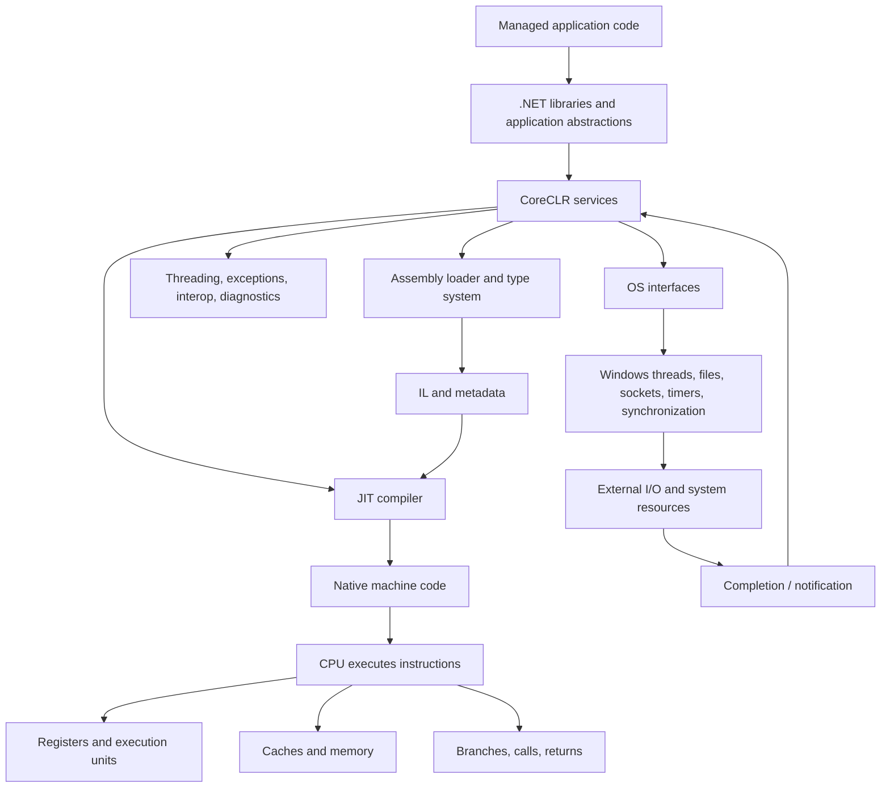

The runtime coordinates managed execution, but it does not replace the operating system. It uses operating-system facilities for threads, sockets, files, memory, timers, and other services.

---

# 11. Async/Await Compiler Transformation

`async` and `await` let code express asynchronous control flow while the compiler transforms the method into state-machine machinery.

## 11.1 High-level C# to state machine

Example:

```csharp
public async Task<string> GetDataAsync()
{
    var response = await client.GetStringAsync(url);
    return response;
}
```

Conceptually:

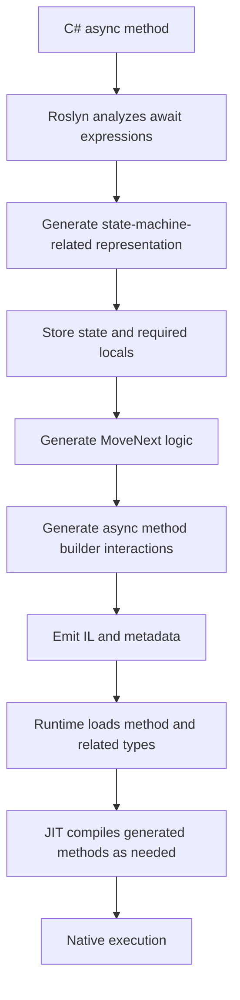

The compiler-generated implementation commonly involves an `IAsyncStateMachine`-style state machine for ordinary task-returning async methods. Exact generated shapes can differ by return type, compiler version, and optimization.

## 11.2 Await state transition

```mermaid
flowchart TD
    A["Enter async method"]
    A --> B["Execute synchronously until await"]
    B --> C["Obtain awaiter"]
    C --> D{"IsCompleted?"}

    D -->|Yes| E["GetResult"]
    E --> F["Continue synchronously"]

    D -->|No| G["Save state and required locals"]
    G --> H["Register continuation"]
    H --> I["Return incomplete Task / ValueTask"]
    I --> J["Awaited operation completes"]
    J --> K["Continuation becomes eligible to run"]
    K --> L["State machine resumes at MoveNext"]
    L --> M["GetResult: obtain result or propagate exception"]
    M --> N["Continue remaining method logic"]

    F --> O["Complete method result"]
    N --> O
```

### Important behavior

- An `async` method starts executing synchronously until it reaches an incomplete await or otherwise returns.
- `await` does not inherently create a new thread.
- If the awaited operation is already complete, execution may continue synchronously.
- If it is incomplete, the state machine records the information needed to resume later.
- The returned task represents completion of the async method, not a dedicated thread.
- Exceptions from the awaited operation are surfaced when the awaiter’s `GetResult` is invoked, and propagate through the async method’s completion mechanism.

## 11.3 Example: asynchronous I/O

```csharp
public async Task<string> DownloadAsync(HttpClient client, string url)
{
    return await client.GetStringAsync(url);
}
```

A conceptual sequence:

1. The method starts on the calling thread.
2. The HTTP operation is initiated.
3. If the operation is incomplete, the async method suspends.
4. The method returns a task representing its eventual completion.
5. The thread that initiated the operation can execute other work.
6. When the operation completes, the continuation is scheduled according to the operation and runtime context.
7. The state machine resumes and completes the task.

The network request is not necessarily performed by a dedicated .NET worker thread. Network I/O generally relies on OS and runtime I/O facilities, with completion notifications used to resume managed processing.

---

# 12. Task, Continuations, and ThreadPool

A `Task` represents an asynchronous operation's completion state and, where applicable, its result, exception, or cancellation. It is not synonymous with a thread.

## 12.1 Task execution architecture

```mermaid
flowchart TD
    A["Application starts operation"]
    A --> B{"Operation type"}

    B -->|CPU-bound work| C["Task.Run or scheduled work"]
    C --> D["TaskScheduler"]
    D --> E["ThreadPool worker executes work"]

    B -->|Asynchronous I/O| F["Initiate OS/runtime I/O"]
    F --> G["Operation remains pending without requiring a dedicated thread"]
    G --> H["I/O completion notification"]
    H --> I["Continuation becomes runnable"]

    E --> J["Operation completes"]
    I --> J

    J --> K["Task completion state updated"]
    K --> L["Continuations execute or become scheduled"]
    L --> M["Awaiting caller resumes"]
```

This is a simplified architecture. Some tasks run synchronously, some are already completed, and scheduling depends on the API, task scheduler, synchronization context, and runtime behavior.

## 12.2 `Task.Run` versus asynchronous I/O

```mermaid
flowchart LR
    A["CPU-intensive calculation"] --> B["Task.Run"]
    B --> C["ThreadPool worker"]
    C --> D["CPU executes calculation"]

    E["HTTP or database asynchronous I/O"] --> F["Start asynchronous operation"]
    F --> G["Wait without blocking the calling thread"]
    G --> H["I/O completion"]
    H --> I["Continuation resumes"]
```

Use `Task.Run` when scheduling work to the ThreadPool is appropriate, especially for CPU-bound work in contexts where moving the work off the current thread is beneficial. It is not normally necessary to wrap naturally asynchronous I/O in `Task.Run`.

## 12.3 Task completion sources

`TaskCompletionSource<T>` allows code to represent an operation with a `Task<T>` even when completion originates from a callback, event, or another non-task-based API.

```mermaid
flowchart TD
    A["Callback-based or external operation"]
    A --> B["TaskCompletionSource<T>"]
    B --> C["Expose Task<T> to consumer"]

    A --> D["Operation completes"]
    D --> E["SetResult / SetException / SetCanceled"]
    E --> F["Task reaches terminal state"]
    F --> G["Registered continuations become eligible to run"]
```

`TrySetResult`, `TrySetException`, and `TrySetCanceled` can be useful when multiple completion paths might race. `RunContinuationsAsynchronously` can prevent consumer continuations from unexpectedly executing inline during completion, at the cost of scheduling overhead.

## 12.4 Continuations and execution context

```mermaid
flowchart TD
    A["Await or continuation registered"]
    A --> B["Operation completes"]
    B --> C["Determine continuation execution behavior"]
    C --> D["ExecutionContext behavior"]
    C --> E["SynchronizationContext / TaskScheduler behavior where applicable"]
    D --> F["Continuation runs or is scheduled"]
    E --> F
    F --> G["State machine or continuation code executes"]
```

`ExecutionContext` can carry ambient information such as logical call context and security-related context. `SynchronizationContext` and `TaskScheduler` influence continuation scheduling in relevant scenarios; they are distinct concepts.

ASP.NET Core does not use the classic ASP.NET request `SynchronizationContext`, so `ConfigureAwait(false)` is not generally required in every ASP.NET Core method merely to avoid returning to a request synchronization context. Library code may still choose `ConfigureAwait(false)` based on its execution-context requirements.

---

# 13. ASP.NET Core: Network Request to Application Response

ASP.NET Core builds on the .NET runtime. The application executes managed code through CoreCLR, while Kestrel and other components handle HTTP and application request processing.

## 13.1 End-to-end HTTP request flow

```mermaid
flowchart TD
    A["Client: browser, mobile app, or service"]
    A --> B["DNS and network connection"]
    B --> C["Load balancer / reverse proxy, if configured"]
    C --> D["Kestrel HTTP server"]
    D --> E["HTTP request parsing"]
    E --> F["ASP.NET Core middleware pipeline"]

    F --> G["Exception handling and logging middleware"]
    G --> H["HTTPS redirection / routing as configured"]
    H --> I["Authentication middleware"]
    I --> J["Authorization middleware"]
    J --> K["Endpoint execution"]

    K --> L["Controller / Minimal API / endpoint handler"]
    L --> M["Dependency injection resolves required services"]
    M --> N["Application and domain logic"]

    N --> O["Database / cache / message broker / external API"]
    O --> P["Return data or result"]
    P --> Q["Serialize response"]
    Q --> R["Middleware unwinds"]
    R --> S["Kestrel sends HTTP response"]
    S --> T["Client receives response"]
```

The exact middleware order depends on the application. For example, exception handling, routing, authentication, authorization, CORS, rate limiting, and endpoint execution must be arranged according to their requirements. HTTPS redirection is not necessarily needed when TLS termination is handled entirely by a trusted proxy and the application is configured appropriately.

## 13.2 Runtime execution underneath the request

```mermaid
flowchart TD
    A["HTTP request reaches Kestrel"]
    A --> B["Managed middleware code"]
    B --> C["Endpoint and application code"]
    C --> D["CoreCLR executes managed methods"]
    D --> E["JIT-generated native code where required"]
    E --> F["CPU executes instructions"]

    C --> G["Await asynchronous I/O"]
    G --> H["Runtime / OS I/O facilities"]
    H --> I["Completion notification"]
    I --> J["Continuation resumes"]
    J --> C

    C --> K["Application result"]
    K --> L["HTTP response generation"]
```

The server can handle many concurrent requests without dedicating a separate blocked thread to every asynchronous I/O operation. Actual throughput and concurrency depend on CPU, connection limits, application behavior, memory use, downstream services, and other constraints.

---

# 14. Dependency Injection: Service Lifetimes and Request Scope

Dependency injection manages the creation and lifetime of application services. It is a library/framework facility operating within the .NET application and runtime.

```mermaid
flowchart TD
    A["ASP.NET Core request"]
    A --> B["Create or use request scope"]
    B --> C["Resolve endpoint/controller"]
    C --> D["Resolve dependencies"]

    D --> E["Transient service"]
    D --> F["Scoped service"]
    D --> G["Singleton service"]

    E --> H["New instance per resolution, normally"]
    F --> I["One instance per scope"]
    G --> J["One instance per service provider/container lifetime"]

    H --> K["Application operation"]
    I --> K
    J --> K
```

### Lifetime considerations

- **Transient:** Typically created each time the service is requested from the container.
- **Scoped:** Typically one instance per scope; in web applications, a request commonly uses a scope.
- **Singleton:** One instance per service provider/container lifetime.

A singleton should not directly capture a scoped service in its constructor because that can cause incorrect lifetime behavior. If a singleton genuinely needs to create scopes for background operations, `IServiceScopeFactory` can be used deliberately.

DI lifetimes describe object construction and retention policies. They do not map directly to CPU threads or processor execution contexts.

---

# 15. End-to-End High-Concurrency API Execution

This final flow combines the HTTP server, managed execution, asynchronous operations, task completion, and native CPU execution.

```mermaid
flowchart TD
    A["Many concurrent clients"]
    A --> B["Network and load balancer"]
    B --> C["Kestrel accepts connections and processes HTTP"]
    C --> D["Middleware pipeline"]
    D --> E["Endpoint handler"]

    E --> F["Application logic executes"]
    F --> G["CPU-bound processing"]
    G --> H["CoreCLR / JIT-generated native instructions"]
    H --> I["CPU execution"]

    F --> J["Asynchronous database / HTTP / storage call"]
    J --> K["Initiate I/O"]
    K --> L["Caller can release its current thread while waiting"]
    L --> M["Other runnable work can use available workers"]

    K --> N["I/O completion"]
    N --> O["Continuation scheduled or invoked"]
    O --> P["Resume async state machine"]
    P --> Q["Process result"]

    I --> R["Construct response"]
    Q --> R
    R --> S["Serialize and send HTTP response"]
    S --> T["Client receives response"]
```

This is the central high-concurrency mental model:

- CPU-bound work consumes CPU time.
- Synchronous blocking holds a thread while it waits.
- Asynchronous I/O can allow a thread to perform other work while the operation is pending.
- Continuations resume when operations complete.
- ThreadPool scheduling, CPU capacity, locks, downstream limits, and request admission policies affect application performance.

Async does not eliminate resource consumption. A pending operation can still retain state, buffers, tasks, and references. Poorly bounded concurrency or incomplete operations can still create memory pressure and resource exhaustion.

---

# 16. Troubleshooting Flow

When a .NET service is slow, investigate the layer responsible rather than assuming every performance issue is caused by the runtime or GC.

```mermaid
flowchart TD
    A["Reported latency, throughput, or availability problem"]
    A --> B["Measure and reproduce"]
    B --> C["Inspect request rate, errors, and latency"]
    C --> D["Identify bottleneck category"]

    D --> E["CPU saturation"]
    D --> F["ThreadPool starvation or blocking"]
    D --> G["Slow database or external dependency"]
    D --> H["Network or connection limits"]
    D --> I["Lock contention / synchronization"]
    D --> J["Memory, allocation, or GC pressure"]
    D --> K["Serialization or application algorithm"]

    E --> L["Profile hot methods and CPU usage"]
    F --> M["Inspect blocking calls, worker availability, and queues"]
    G --> N["Inspect query plans, dependency latency, and timeouts"]
    H --> O["Inspect connection pools, DNS, network, and throttling"]
    I --> P["Inspect lock contention and critical sections"]
    J --> Q["Inspect allocations, live memory, and GC metrics"]
    K --> R["Profile algorithms and payload processing"]

    L --> S["Make targeted change"]
    M --> S
    N --> S
    O --> S
    P --> S
    Q --> S
    R --> S

    S --> T["Re-test against the same workload"]
    T --> U{"Did measured outcome improve?"}
    U -->|Yes| V["Validate correctness and production impact"]
    U -->|No| B
```

Useful observability models:

- **RED:** Rate, Errors, Duration — especially useful for request-driven services.
- **USE:** Utilization, Saturation, Errors — useful for resources such as CPU, disks, and queues.

The investigation should correlate application metrics, traces, logs, runtime metrics, and downstream dependency telemetry.

---

# 17. Final Master Mental Model

```mermaid
flowchart TD
    A["Source code"]
    A --> B["Roslyn: lex, parse, bind, lower"]
    B --> C["IL + metadata in PE assembly"]
    C --> D["Windows process startup"]
    D --> E[".NET host: runtime resolution and activation"]
    E --> F["CoreCLR initialization"]
    F --> G["Assembly loading and type resolution"]
    G --> H["JIT compilation when required"]
    H --> I["Native machine code"]
    I --> J["CPU: fetch, decode, execute"]
    J --> K["Registers, caches, memory, OS interaction"]

    K --> L["Application behavior"]
    L --> M["Tasks, async state machines, and I/O"]
    M --> N["Continuations and resumed execution"]
    N --> J

    L --> O["ASP.NET Core request processing"]
    O --> P["Middleware, DI, endpoint, business logic"]
    P --> Q["Database / cache / messaging / external APIs"]
    Q --> L
```

## Core principles to remember

1. **Roslyn compiles source code into IL and metadata.** It does not ordinarily generate final native instructions for every method at build time.
2. **A managed assembly is a structured PE file.** It contains metadata and IL method bodies, along with other structures and optional content.
3. **Windows starts the process; the .NET host activates the runtime.** The Windows loader and CoreCLR perform different jobs.
4. **CoreCLR manages execution.** Its responsibilities extend beyond the JIT to loading, types, threading, exceptions, interop, diagnostics, and memory management.
5. **The JIT maps IL semantics to native instructions.** It does not need to translate each IL instruction one-for-one.
6. **The CPU executes native machine instructions.** Registers, execution units, caches, and memory participate in execution; the CPU does not directly understand C# or `Task`.
7. **`Task` represents asynchronous completion, not a thread.** Async/await is compiler-generated control flow coordinated with runtime and library facilities.
8. **Asynchronous I/O and CPU-bound work have different execution characteristics.** Async I/O can free a thread while waiting; CPU-bound work still requires processor time.
9. **ASP.NET Core is built on these layers.** Kestrel, middleware, DI, endpoint code, and downstream calls ultimately depend on runtime execution, OS facilities, and CPU resources.
10. **Use the correct layer when diagnosing issues.** Compiler errors, runtime-loading failures, JIT behavior, CPU saturation, thread blocking, I/O latency, and memory pressure are different classes of problems.

