# .NET Garbage Collector (GC) — Complete End-to-End Architecture Flowcharts

> Scope: .NET / CoreCLR, including allocation internals, managed heap organization, GC roots, reachability analysis, generations, write barriers, collection phases, compaction, finalization, background GC, and production diagnostics.
>
> **Diagram convention:** These are conceptual architecture flowcharts. Actual execution paths and phase ordering vary by runtime version, GC mode, object type, and collection strategy.

---

## Table of Contents

1. [Complete End-to-End .NET GC Architecture](#flowchart-1-complete-end-to-end-net-gc-architecture)
2. [Object Allocation — From `new` to Constructor Execution](#flowchart-2-object-allocation--from-new-to-constructor-execution)
3. [Managed Heap Organization](#flowchart-3-managed-heap-organization)
4. [What Triggers GC?](#flowchart-4-what-triggers-gc)
5. [GC Roots and Object Reachability](#flowchart-5-gc-roots-and-object-reachability)
6. [Generational GC and Promotion](#flowchart-6-generational-gc-and-promotion)
7. [Write Barrier and Remembered-Set Architecture](#flowchart-7-write-barrier-and-remembered-set-architecture)
8. [Complete GC Collection Phases](#flowchart-8-complete-gc-collection-phases)
9. [Sweep vs. Compact vs. Relocate vs. Promote](#flowchart-9-sweep-vs-compact-vs-relocate-vs-promote)
10. [Blocking GC vs. Background GC](#flowchart-10-blocking-gc-vs-background-gc)
11. [Finalization and Object Reclamation](#flowchart-11-finalization-and-object-reclamation)
12. [Workstation GC vs. Server GC](#flowchart-12-workstation-gc-vs-server-gc)
13. [Allocation Rate, Live Set and Memory Retention](#flowchart-13-allocation-rate-live-set-and-memory-retention)
14. [Production Troubleshooting — High CPU and Latency](#flowchart-14-production-troubleshooting--high-cpu-and-latency)
15. [Complete GC Decision Tree for Revision](#flowchart-15-complete-gc-decision-tree-for-revision)

---

# Flowchart 1: Complete End-to-End .NET GC Architecture

This is the master flowchart connecting application execution, object allocation, GC triggering, reachability analysis, memory reclamation, and application resumption.

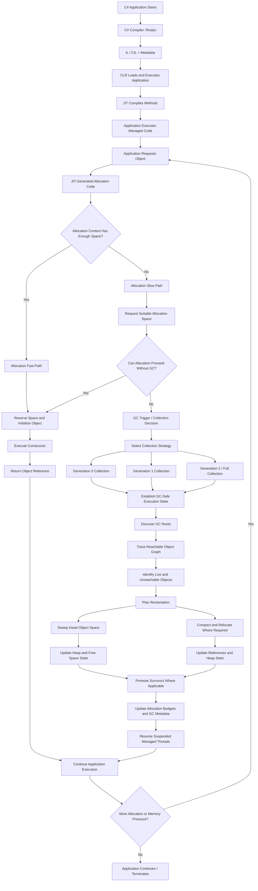

### How to read the master flowchart

1. The compiler generates IL; the CLR and JIT execute the program.
2. The allocation path attempts to allocate from an existing allocation context.
3. If the fast path cannot satisfy the request, the slow path obtains suitable space or participates in a GC decision.
4. When collection occurs, the runtime identifies live objects and determines which memory can be reclaimed.
5. Depending on the collection strategy, the GC sweeps, compacts, or performs a combination of operations.
6. The runtime updates heap state and resumes execution after any required pauses.

A collection does not necessarily compact the heap, and allocation-context exhaustion does not necessarily trigger a collection.

---

# Flowchart 2: Object Allocation — From `new` to Constructor Execution

Consider:

```csharp
var customer = new Customer(42);
```

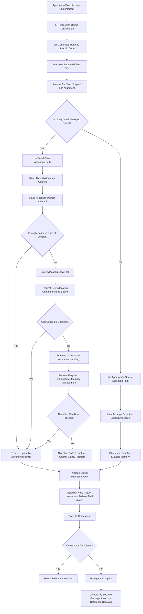

### Allocation internals

- The allocator generally obtains space from memory already managed by the CLR rather than requesting memory from the operating system for every object.
- The allocation fast path is often implemented using a pointer and limit check.
- Per-thread allocation contexts reduce contention between threads allocating small objects.
- The slow path can obtain another allocation context, request more space, or trigger a collection when necessary.
- A newly allocated object has valid runtime metadata and default field values before its constructor's logic executes.
- If a constructor throws, the object is not necessarily reclaimed immediately; it becomes collectible if it is no longer reachable.

---

# Flowchart 3: Managed Heap Organization

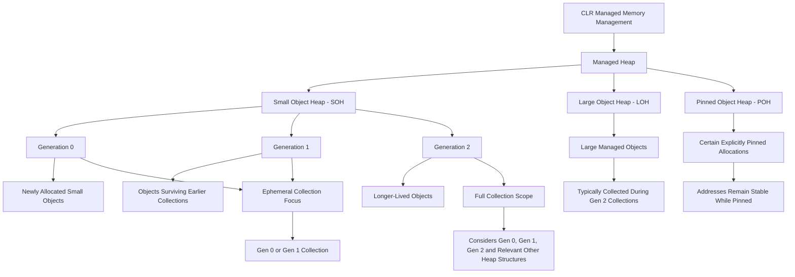

### Important distinctions

- Generations 0, 1, and 2 apply to the ordinary generational organization of the SOH.
- The LOH is generally collected as part of generation 2 collections.
- The POH is used for certain pinned allocations and is not a fourth ordinary generation.
- The commonly used LOH allocation threshold is 85,000 bytes; actual classification depends on the runtime's object-size calculation.
- The GC may retain reclaimed heap memory for future managed allocations instead of returning it immediately to the operating system.

---

# Flowchart 4: What Triggers GC?

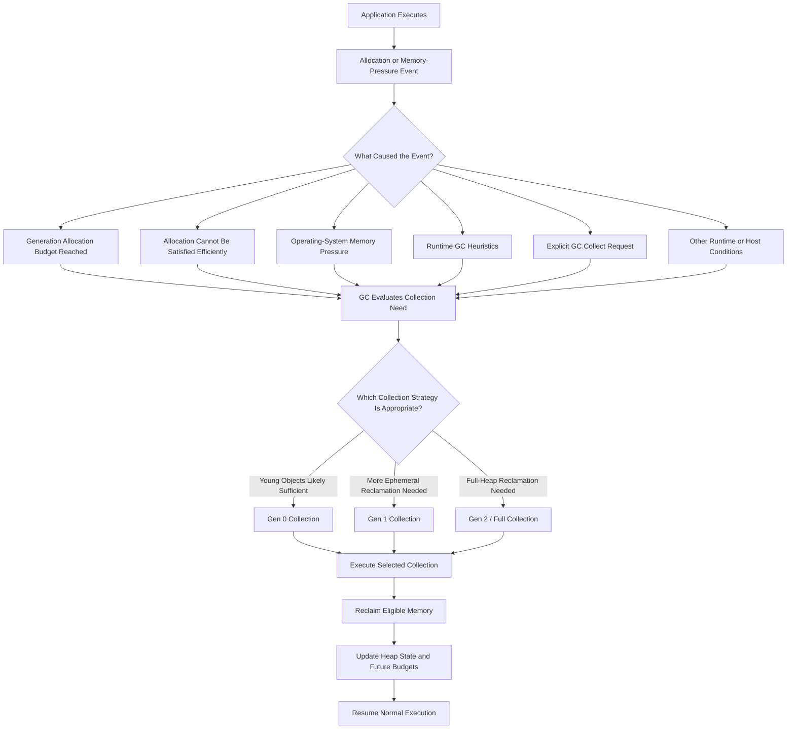

### Allocation budgets

Allocation budgets are dynamic. They depend on runtime heuristics, previous collection outcomes, survival rates, memory pressure, and other factors.

There is no single universal Gen 0 size or fixed allocation threshold that applies to every .NET application.

`GC.Collect()` can request a collection, but it should not ordinarily be used as a routine optimization strategy.

---

# Flowchart 5: GC Roots and Object Reachability

The GC determines liveness through reachability rather than reference counting.

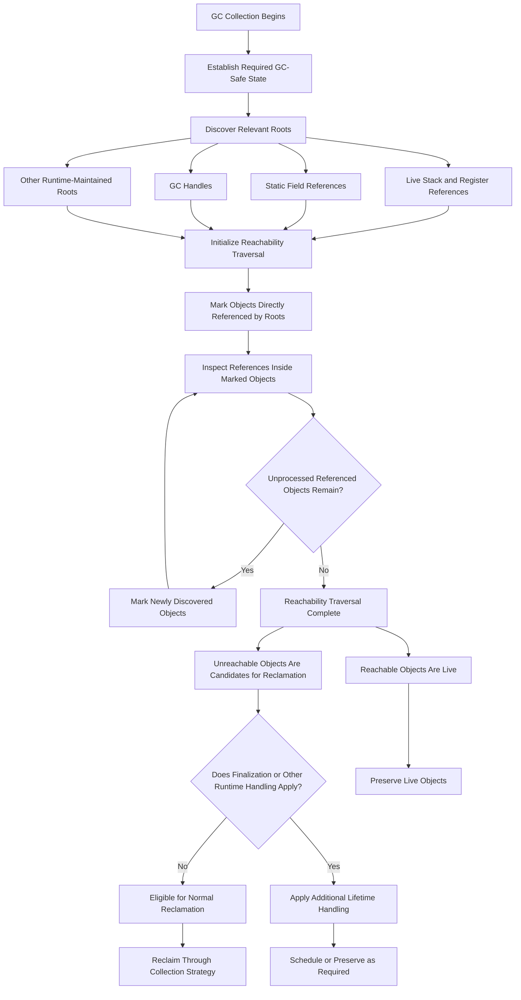

### Example object graph

```text
Live Root
   |
   v
Customer
   |
   +------> Address
   |           |
   |           v
   |         Country
   |
   +------> Preferences

Unreachable Object A ------> Unreachable Object B
         ^                           |
         |___________________________|
```

The `Customer`, `Address`, `Country`, and `Preferences` objects are live if reachable from a live root.

The circular reference between `Object A` and `Object B` does not keep them alive if neither can be reached from any GC root.

### JIT liveness

A local variable's source-code scope is not necessarily its exact GC lifetime. The JIT may determine that a reference is no longer needed before the method ends.

Statics, long-lived collections, closures, event subscriptions, and GC handles can extend object lifetimes.

---

# Flowchart 6: Generational GC and Promotion

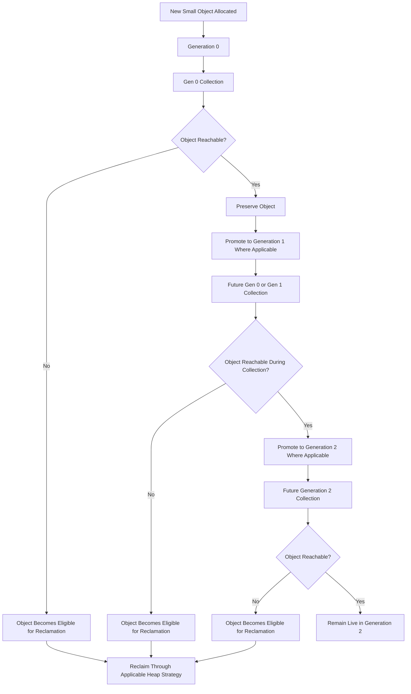

### Collection scope

```text
Collect Gen 0:
    Gen 0 is collected.

Collect Gen 1:
    Gen 0 and Gen 1 are collected.

Collect Gen 2:
    Gen 0, Gen 1 and Gen 2 are considered.
    LOH and relevant other heap structures are also considered.
```

Promotion is a logical generation change. Physical relocation may or may not occur during the same collection.

---

# Flowchart 7: Write Barrier and Remembered-Set Architecture

An older object can reference a younger object. The GC must account for this when collecting only younger generations.

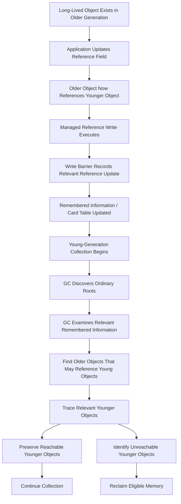

### Why the write barrier matters

Without remembered information, a young-generation collection could miss a young object referenced only by an older object.

The write barrier helps preserve correctness while allowing the collector to avoid scanning every older object during every young-generation collection.

The card table is one implementation mechanism. It records relevant memory regions rather than acting as a direct inventory of all live references.

---

# Flowchart 8: Complete GC Collection Phases

This is the core collector workflow.

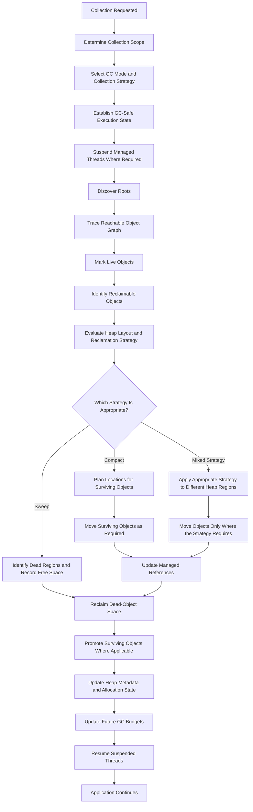

### Phase explanations

1. **Collection request:** The allocator or runtime identifies a need for collection.
2. **Collection scope:** The runtime determines which generations and heap structures must be considered.
3. **Safe execution:** Managed threads are coordinated so the GC can correctly inspect references and update memory.
4. **Root discovery and marking:** Reachability determines which objects are live.
5. **Reclamation planning:** The GC determines how to recover space.
6. **Sweep or compact:** Dead memory is reclaimed, and surviving objects may be moved.
7. **Reference correction:** Managed references are updated if objects relocate.
8. **Promotion and bookkeeping:** Surviving objects and heap structures are updated.
9. **Resume:** Suspended application threads continue execution.

Not every collection performs every operation in precisely this sequence. Background collection, LOH handling, and different heap segments can involve different phase schedules.

---

# Flowchart 9: Sweep vs. Compact vs. Relocate vs. Promote

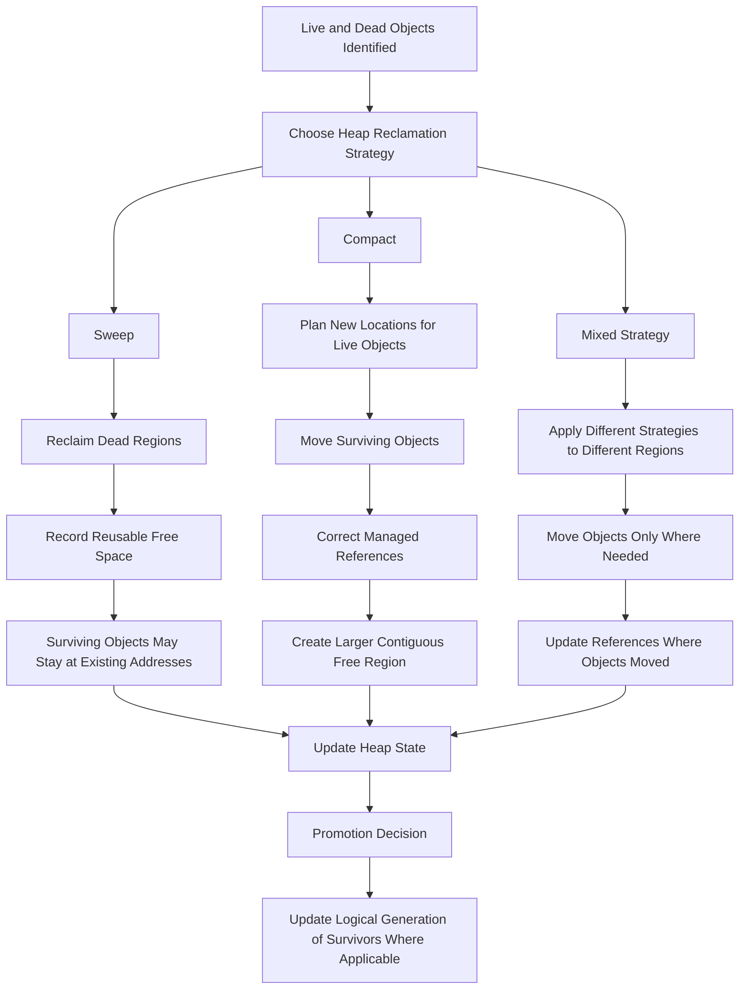

### Visual example

Before compaction:

```text
+--------------------------------------------------+
| Live A | Dead B | Live C | Dead D | Live E       |
+--------------------------------------------------+
```

After compaction:

```text
+--------------------------------------------------+
| Live A | Live C | Live E |       Free Space      |
+--------------------------------------------------+
```

Compaction is useful for reducing fragmentation, but moving objects requires work. Pinning and heap-specific constraints can limit compaction.

---

# Flowchart 10: Blocking GC vs. Background GC

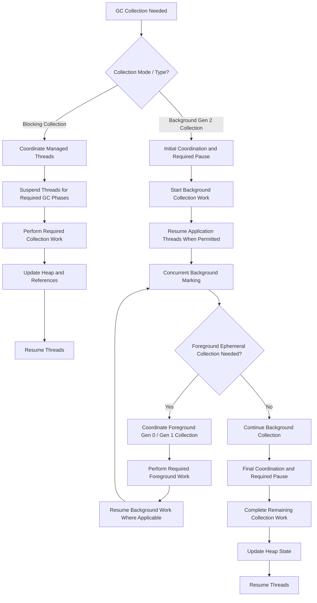

### Important interpretation

- Blocking GC can stop managed application execution during required collection phases.
- Background GC allows significant generation 2 collection work to overlap with application execution.
- Background GC still requires pauses for specific phases.
- A foreground Gen 0 or Gen 1 collection may occur while a background Gen 2 collection is in progress.
- Actual phase ordering depends on the runtime implementation and the state of the heap.

---

# Flowchart 11: Finalization and Object Reclamation

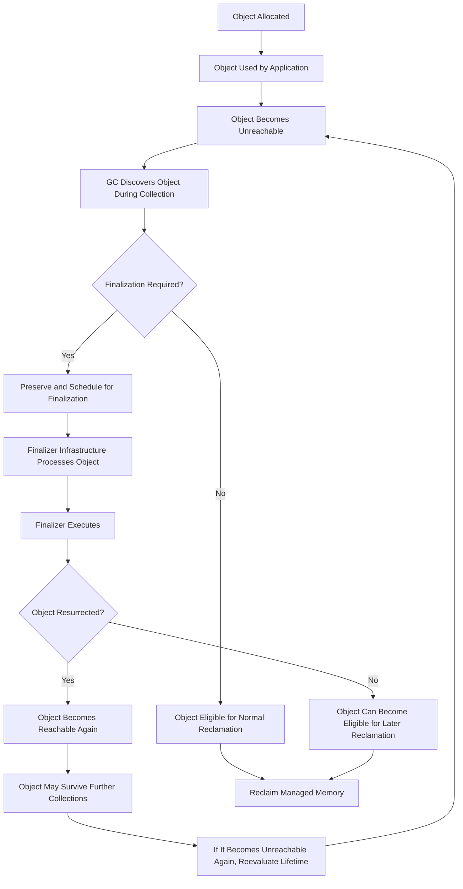

### Cleanup architecture

```text
Application
    |
    +-- using / Dispose
    |       |
    |       v
    |   Deterministic Cleanup
    |
    +-- SafeHandle
    |       |
    |       v
    |   Reliable Native-Resource Lifetime Management
    |
    +-- Finalizer
            |
            v
        Fallback Cleanup
        with Nondeterministic Timing
```

A finalizer is not a substitute for deterministic disposal. Finalization can delay memory reclamation, and its execution time is not predictable.

---

# Flowchart 12: Workstation GC vs. Server GC

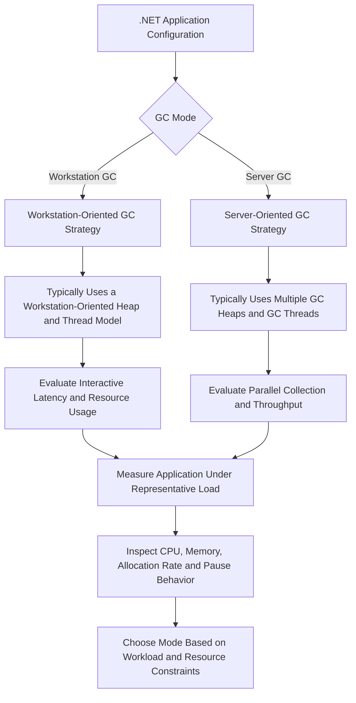

### Architecture trade-offs

| Consideration | Workstation GC | Server GC |
|---|---|---|
| Primary orientation | Client and interactive workloads | Server throughput and parallel workloads |
| Parallelism | Workstation-oriented collection strategy | Typically parallel across multiple GC heaps |
| CPU use | Depends on workload and configuration | Can use more CPU resources during collection |
| Memory use | Depends on workload and configuration | Can have additional heap and thread overhead |
| Best choice | Must be measured | Must be measured |

Neither mode is universally best. Consider CPU quotas, container memory limits, concurrency, and latency requirements.

---

# Flowchart 13: Allocation Rate, Live Set and Memory Retention

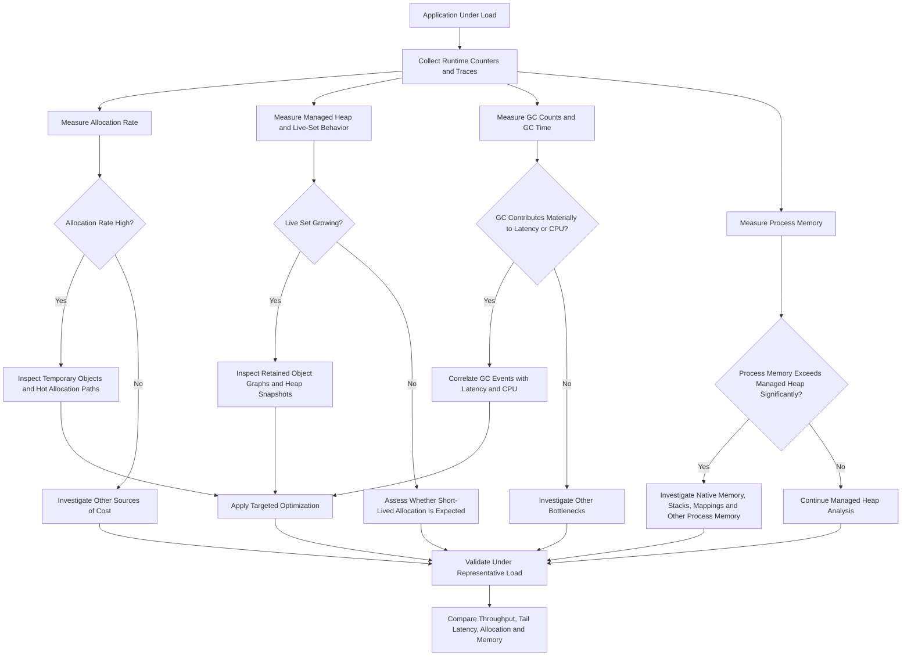

### Metric interpretation

- **High allocation rate:** The application creates objects quickly.
- **High live set:** Many objects remain reachable and must be preserved.
- **High retained memory:** Long-lived references keep objects alive.
- **High GC time:** Collection work is consuming a meaningful share of execution time.
- **High process memory:** May include managed heap memory, native allocations, stacks, and other operating-system-managed memory.

High allocation rate alone does not prove a memory leak. Growing retention and an unexpectedly increasing live set deserve separate investigation.

---

# Flowchart 14: Production Troubleshooting — High CPU and Latency

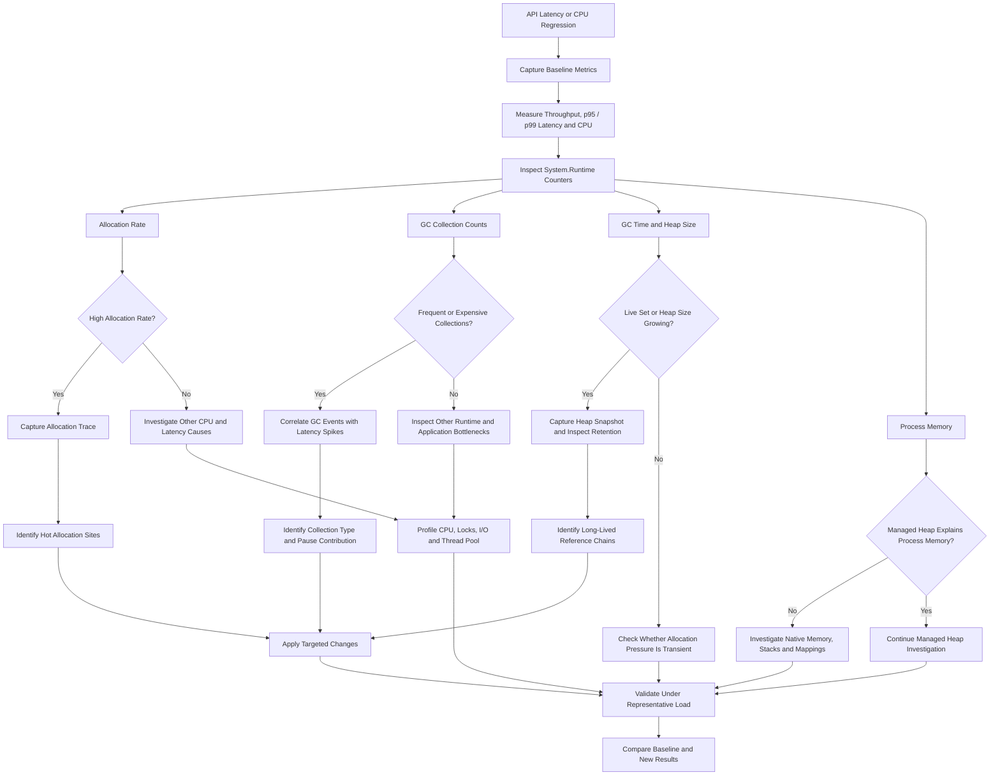

### Example optimization choices

| Finding | Potential action |
|---|---|
| Many temporary strings | Reduce repeated concatenation; measure alternatives such as `StringBuilder`. |
| Repeated temporary collections | Reduce unnecessary intermediates or reuse storage where safe. |
| Large arrays repeatedly allocated | Stream data or use appropriate buffer pooling. |
| Cache grows without bounds | Apply explicit cache capacity and expiration policies. |
| Event subscriptions retain objects | Unsubscribe or redesign ownership. |
| High native memory | Profile native allocations and interop lifetimes. |
| GC is not a major bottleneck | Investigate CPU, database, networking, locking, and thread-pool behavior. |

---

# Flowchart 15: Complete GC Decision Tree for Revision

Use this final flowchart to revise the whole architecture quickly.

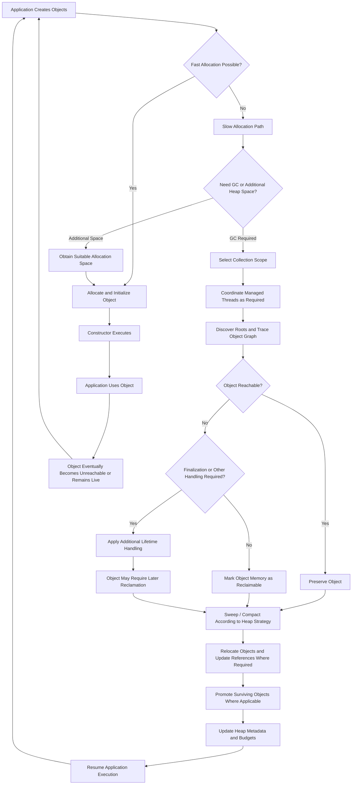

---

**Final mental model:** Allocation creates objects efficiently; roots and tracing determine liveness; generational policies limit collection work; write barriers preserve cross-generation correctness; sweep and compaction recover usable memory; promotion tracks survivors; finalization can delay reclamation; and runtime diagnostics tell you whether allocation, retention, GC pauses, or non-managed memory is causing a production problem.
