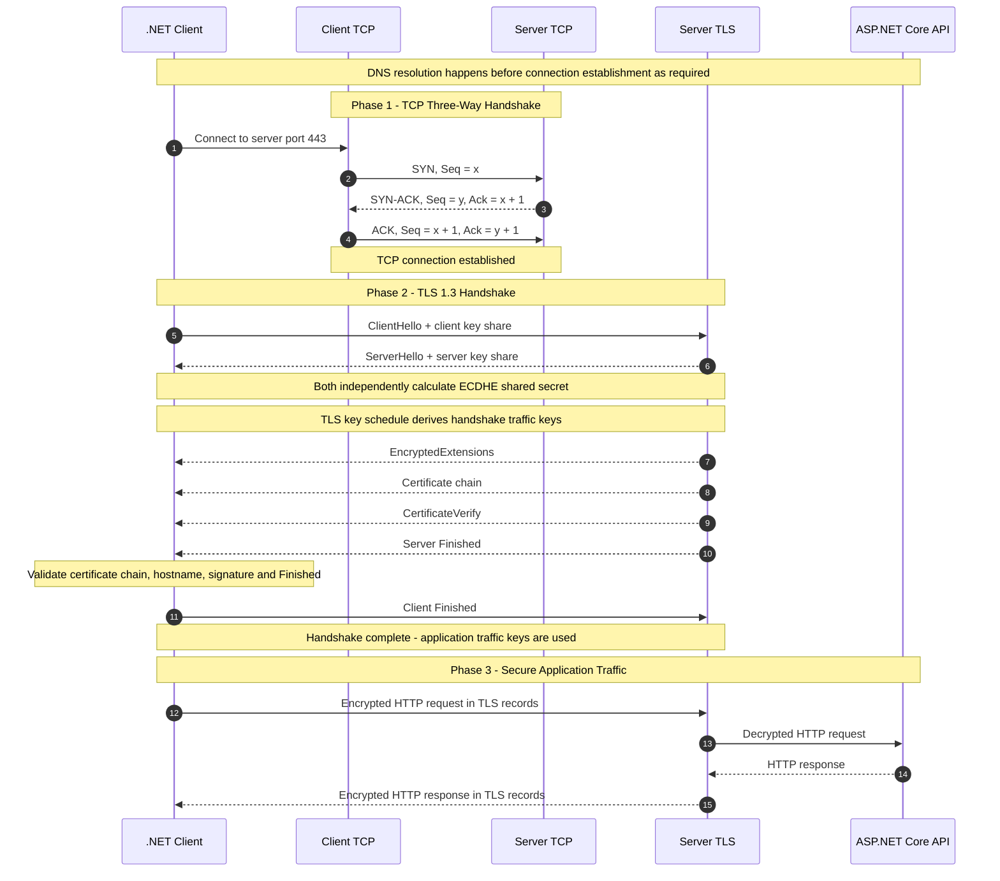
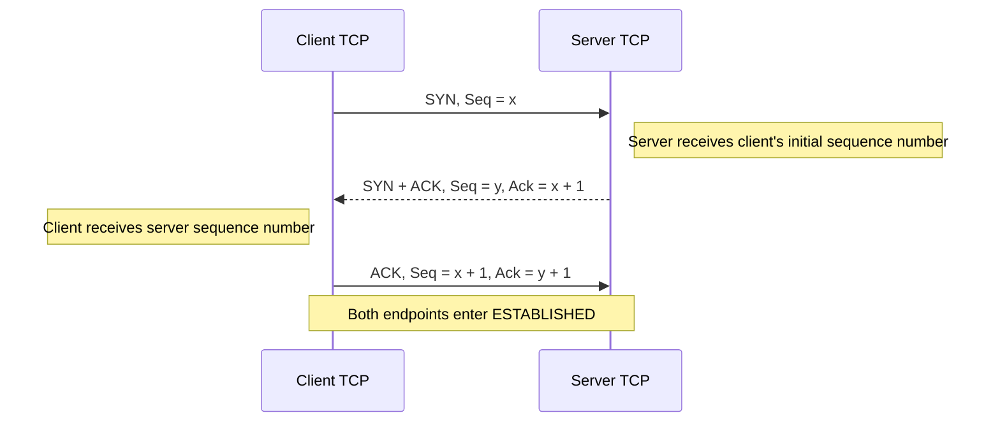
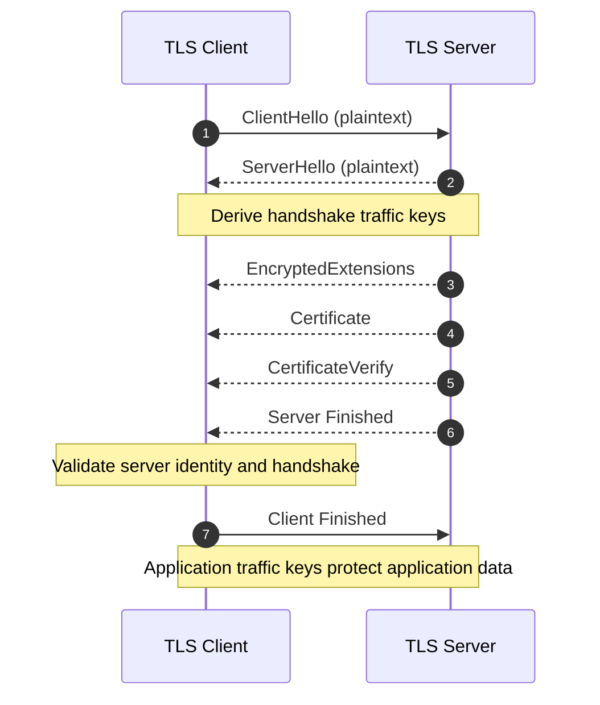
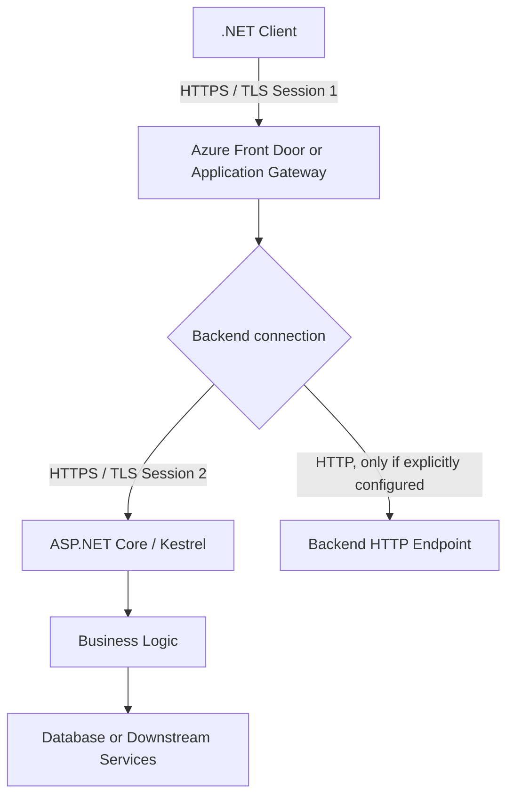

# End-to-End TCP Three-Way Handshake and TLS 1.3 Handshake Architecture

## Table of Contents

1. [Overview](#1-overview)
2. [Complete End-to-End Sequence Diagram](#2-complete-end-to-end-sequence-diagram)
3. [TCP Three-Way Handshake](#3-tcp-three-way-handshake)
4. [TLS Architecture](#4-tls-architecture)
5. [Certificates and Certificate Authorities](#5-certificates-and-certificate-authorities)
6. [Complete TLS 1.3 Handshake](#6-complete-tls-13-handshake)
7. [TLS Record Layer and HTTP Data Protection](#7-tls-record-layer-and-http-data-protection)
8. [TCP and TLS Handshake Comparison](#8-tcp-and-tls-handshake-comparison)
9. [TLS 1.2 Versus TLS 1.3](#9-tls-12-versus-tls-13)
10. [Forward Secrecy](#10-forward-secrecy)
11. [Azure and .NET Architecture](#11-azure-and-net-architecture)
12. [Troubleshooting TCP and TLS](#12-troubleshooting-tcp-and-tls)
13. [Important Questions and Answers](#13-Important-questions-and-answers)
14. [Final End-to-End Architecture Flow](#14-final-end-to-end-architecture-flow)

---

## 1. Overview

When a client application, such as a .NET application using `HttpClient`, calls an HTTPS API, two major protocols work together:

- **TCP (Transmission Control Protocol):** Establishes a reliable, ordered, connection-oriented byte stream.
- **TLS (Transport Layer Security):** Establishes a secure communication channel using cryptographic key agreement, authentication, encryption, and integrity protection.

HTTPS is HTTP carried over TLS. For conventional HTTP/1.1 and HTTP/2, TLS runs over TCP. HTTP/3 uses QUIC over UDP, with TLS 1.3 integrated into QUIC.

### End-to-end protocol stack

```text
+-------------------------------------------------------+
|                  CLIENT APPLICATION                  |
|             .NET HttpClient / Browser                 |
+-------------------------------------------------------+
                         |
                         v
+-------------------------------------------------------+
|                 APPLICATION LAYER                    |
|             HTTP Request / Response                   |
+-------------------------------------------------------+
                         |
                         v
+-------------------------------------------------------+
|                    TLS LAYER                          |
| Certificates, Key Agreement, Key Derivation           |
| Encryption, Integrity, Authentication                 |
+-------------------------------------------------------+
                         |
                         v
+-------------------------------------------------------+
|                    TCP LAYER                          |
| Connection Establishment, Reliability, Ordering       |
| Retransmission, Flow Control, Congestion Control      |
+-------------------------------------------------------+
                         |
                         v
+-------------------------------------------------------+
|                     IP LAYER                          |
|             Addressing and Routing                    |
+-------------------------------------------------------+
                         |
                         v
+-------------------------------------------------------+
|                 NETWORK / INTERNET                    |
+-------------------------------------------------------+
                         |
                         v
+-------------------------------------------------------+
|                 SERVER / API ENDPOINT                 |
+-------------------------------------------------------+
```

### Responsibilities

| Component | Responsibility |
|---|---|
| DNS | Resolves a hostname to an IP address, subject to caching and network configuration |
| TCP | Reliable, ordered byte-stream transport |
| TLS | Cryptographic security and peer authentication as configured |
| HTTP | Application request and response semantics |
| ASP.NET Core | Application middleware, authentication, authorization, and business logic |
| Azure gateway or reverse proxy | May terminate TLS, route requests, apply policies, and establish a separate backend connection |

**Important:** TCP does not provide encryption or certificate-based identity verification. TLS does not replace TCP's reliable transport functionality.

---

# 2. Complete End-to-End Sequence Diagram

This diagram represents a new TCP connection followed by a full, certificate-based TLS 1.3 handshake using ephemeral Diffie–Hellman key agreement. It assumes ordinary server authentication without a client certificate.



The actual flow can vary with session resumption, `HelloRetryRequest`, client-certificate authentication, proxies, and other negotiated options.

---

# 3. TCP Three-Way Handshake

## 3.1 What is TCP?

TCP is a transport-layer protocol that establishes a connection between two endpoints and provides a reliable, ordered byte stream.

TCP provides:

- Connection establishment and teardown.
- Sequence numbers and acknowledgements.
- Retransmission of lost data.
- In-order delivery to the receiving application.
- Flow control using receive-window information.
- Congestion control to manage network traffic.
- Full-duplex communication.

TCP does not understand HTTP request semantics, TLS certificates, encryption keys, or application authorization.

## 3.2 TCP connection identification

A TCP connection is commonly identified by the four-tuple:

```text
Source IP
Source Port
Destination IP
Destination Port
```

Example:

```text
Client IP:       192.168.1.10
Client Port:     51500
Server IP:       203.0.113.20
Server Port:     443
Protocol:        TCP
```

The operating system maintains connection state for this flow.

## 3.3 TCP handshake flow



## 3.4 Step 1: Client sends SYN

The client initiates a TCP connection by sending a segment with the SYN flag set.

Example:

```text
Source:      192.168.1.10:51500
Destination: 203.0.113.20:443

Flags: SYN
Sequence Number: x
```

The client communicates its initial sequence number and may advertise TCP options such as maximum segment size, window scaling, and selective acknowledgement capability.

The client enters the `SYN-SENT` state.

The SYN consumes one sequence number even though it does not carry application data.

## 3.5 Step 2: Server sends SYN-ACK

The server receives the SYN and responds with a segment containing both SYN and ACK flags.

```text
Flags: SYN + ACK
Sequence Number: y
Acknowledgement Number: x + 1
```

The acknowledgement `x + 1` confirms receipt of the client's SYN.

The server communicates its own initial sequence number, `y`, and enters the `SYN-RECEIVED` state while waiting for the final ACK.

## 3.6 Step 3: Client sends ACK

The client acknowledges the server's SYN.

```text
Flags: ACK
Sequence Number: x + 1
Acknowledgement Number: y + 1
```

The client enters `ESTABLISHED`. After receiving the ACK, the server also enters `ESTABLISHED`.

The TCP connection is now ready to transport bytes.

## 3.7 Why are three messages required?

1. The client communicates its initial sequence number.
2. The server acknowledges the client and communicates its own initial sequence number.
3. The client acknowledges the server's sequence number.

This synchronizes the endpoints' TCP state and confirms bidirectional reachability for the handshake exchange.

It does not authenticate the server's real-world identity or protect the application payload cryptographically.

## 3.8 What happens after TCP establishment?

For conventional HTTPS over TCP:

```text
TCP connection established
          |
          v
Client sends TLS ClientHello
          |
          v
TLS negotiation and authentication
          |
          v
TLS application traffic keys become available
          |
          v
Encrypted HTTP request and response
```

A TCP connection can be established successfully even if the subsequent TLS handshake fails.

---

# 4. TLS Architecture

## 4.1 What is TLS?

TLS stands for Transport Layer Security. It provides cryptographic protection to application protocols that run over a transport connection.

TLS provides:

| Property | Purpose |
|---|---|
| Confidentiality | Prevents passive observers from reading protected application data |
| Integrity | Detects unauthorized modification of protected records |
| Server authentication | Validates server identity using certificates and proof of private-key possession |
| Key establishment | Establishes shared secret material from which traffic keys are derived |
| Forward secrecy | Ephemeral key agreement can protect previous sessions against later compromise of the long-term server key |

TLS does not automatically provide application authorization, prevent malicious behavior by a trusted endpoint, or guarantee that the application itself is secure.

## 4.2 Cryptographic building blocks

TLS uses several cryptographic mechanisms together.

### A. Asymmetric cryptography

Asymmetric cryptography uses a public key and a corresponding private key.

```text
Public Key:
- Can be distributed.
- Used to verify digital signatures.
- May be used in public-key encryption schemes.
- Participates in public-key algorithms as specified by the protocol.

Private Key:
- Must remain protected.
- Used to create digital signatures.
- Used in the relevant private-key operations.
```

Common examples include RSA and elliptic-curve cryptography.

**TLS 1.3 Important point:** A typical TLS 1.3 handshake does not encrypt the entire HTTP request with the server's RSA public key. It generally uses ephemeral Diffie–Hellman key agreement, followed by symmetric encryption using derived traffic keys.

### B. Symmetric encryption

Symmetric encryption uses secret key material shared by the communicating endpoints.

Examples include:

- AES-GCM.
- ChaCha20-Poly1305.

These are authenticated-encryption-with-associated-data (AEAD) algorithms.

Conceptually:

```text
Plaintext + Secret Key + Nonce + Associated Data
                       |
                       v
                 AEAD Encryption
                       |
                       v
              Ciphertext + Tag
```

The receiver authenticates and decrypts the record using the corresponding key and nonce. If authentication fails, the record must be rejected.

### C. Hashing

A cryptographic hash converts data of arbitrary length into a fixed-length digest.

Example:

```text
Input data
    |
    v
SHA-256
    |
    v
256-bit digest
```

Hashing is not encryption. A hash is not designed to be decrypted to recover the original input.

TLS uses hashes in transcript processing, digital-signature operations, and key derivation.

### D. Digital signatures

A digital signature proves that the signer has access to the relevant private key and binds the signature to the signed data.

```text
Handshake transcript
        |
        v
Signature operation using private key
        |
        v
Digital signature
        |
        v
Verification using corresponding public key
```

In TLS 1.3, `CertificateVerify` proves possession of the private key associated with the server certificate and binds that proof to the handshake transcript.

### E. Diffie–Hellman key agreement

Ephemeral Diffie–Hellman allows two parties to calculate matching shared secret material without transmitting their private values.

The public shares are sent over the network, while the private values remain secret.

The shared secret feeds the TLS key schedule; it is not used directly as the HTTP encryption key.

---

# 5. Certificates and Certificate Authorities

## 5.1 What is an X.509 certificate?

An X.509 certificate binds an identity to a public key through a certificate issuer's digital signature.

A server certificate typically contains:

- Subject information.
- Subject Alternative Names (SANs).
- Public key.
- Issuer information.
- Validity period.
- Key usage and extended key usage.
- Issuer's digital signature.

The certificate does not contain the server's private key.

## 5.2 Certificate trust chain

```text
              Trusted Root CA
                     |
                     | signs
                     v
              Intermediate CA
                     |
                     | signs
                     v
             Server / Leaf Certificate
                     |
                     +-- SAN: api.example.com
                     +-- Public key
                     +-- Validity dates
                     +-- Server authentication usage
```

The client validates the certificate chain against its trust store and applies hostname, validity, and certificate-usage checks. The root certificate is often already trusted by the client and may not be transmitted by the server.

## 5.3 Certificate validation checks

A client normally checks:

1. The chain terminates at a trusted root.
2. The certificate is within its validity period.
3. The requested hostname matches the certificate's SAN.
4. Certificate usage is appropriate for server authentication.
5. Certificate signatures and constraints are valid.
6. Any applicable revocation checks meet the client's configured policy.

A certificate can have a valid issuer signature and still be rejected because it is expired, issued for the wrong hostname, untrusted, or unsuitable for the intended purpose.

---

# 6. Complete TLS 1.3 Handshake

## 6.1 TLS 1.3 message flow

The following is a typical full TLS 1.3 handshake using ephemeral Diffie–Hellman and certificate-based server authentication.



## 6.2 Visibility of TLS messages

| Message | Normally encrypted? | Purpose |
|---|---|---|
| ClientHello | No | Client capabilities, negotiation, and key share |
| ServerHello | No | Selected parameters and server key share |
| EncryptedExtensions | Yes | Negotiated extensions |
| Certificate | Yes in TLS 1.3 after ServerHello | Server certificate chain |
| CertificateVerify | Yes | Proof of possession of certificate private key |
| Finished | Yes | Handshake transcript verification |
| Application Data | Yes | Protected application data |

In TLS 1.3, messages after `ServerHello` are normally protected with handshake traffic keys, subject to the defined protocol flow.

The ordinary SNI hostname in ClientHello is generally visible to passive observers unless Encrypted Client Hello (ECH) is used.

## 6.3 Step 1: ClientHello

The client sends a `ClientHello` containing supported protocol parameters and extensions.

Conceptually:

```text
ClientHello
|
+-- Supported TLS versions
|      +-- TLS 1.3, if supported
|
+-- Cipher suites
|      +-- Supported AEAD and hash combinations
|
+-- Supported groups
|      +-- Example: X25519
|
+-- Key share
|      +-- Client ephemeral public key share
|
+-- Signature algorithms
|
+-- Server Name Indication (SNI)
|      +-- api.example.com
|
+-- ALPN
|      +-- h2 / http/1.1
|
+-- Client random
|
+-- Other extensions
```

The client generates an ephemeral private value and its corresponding public share.

Conceptually:

```text
Client ephemeral private value = a
Client public share            = A = a × G
```

Here, `G` represents the base point of the selected elliptic-curve group. This is simplified notation for elliptic-curve Diffie–Hellman.

The client transmits `A`, not `a`.

The client is negotiating a secure connection at this point; it has not yet sent its ordinary HTTP request.

### Why include a key share?

If the server can use the offered group and key share, it can respond with its own share immediately, avoiding an additional negotiation round trip.

If no suitable share is available, the server may send `HelloRetryRequest`, which asks the client to provide a suitable share and adds another handshake exchange.

## 6.4 Step 2: ServerHello

The server selects compatible TLS parameters and returns a `ServerHello`.

Example:

```text
ServerHello
|
+-- Selected TLS version: TLS 1.3
+-- Selected cipher suite: TLS_AES_128_GCM_SHA256
+-- Selected key-agreement group: X25519
+-- Server ephemeral public key share: B
+-- Other negotiation values
```

The exact selections depend on client support, server configuration, platform capabilities, and cryptographic policy.

The server generates its own ephemeral private value and corresponding public share:

```text
Server ephemeral private value = b
Server public share            = B = b × G
```

The server sends `B` to the client. Both sides now have the peer's public share and their own private value.

## 6.5 Step 3: Calculate the ECDHE shared secret

The client knows its private value `a` and the server's public share `B`.

The server knows its private value `b` and the client's public share `A`.

They calculate:

```text
Client:
    SharedSecret = a × B
                 = a × (b × G)
                 = ab × G

Server:
    SharedSecret = b × A
                 = b × (a × G)
                 = ab × G
```

Therefore:

```text
Client SharedSecret == Server SharedSecret
```

The network observer can see `A` and `B`, but should not be able to feasibly recover the shared secret without the private values, assuming the chosen group and implementation remain secure.

The shared secret is not directly used as the HTTP encryption key. It is input to the TLS key schedule.

## 6.6 Step 4: TLS 1.3 key schedule

TLS 1.3 uses HKDF, a key derivation function, together with the negotiated hash and handshake transcript to derive the secrets and traffic keys used by the connection.

Conceptual flow:

```text
ECDHE shared secret
         |
         v
HKDF-based TLS key schedule
         |
         +-----------------------------+
         |                             |
         v                             v
Client handshake traffic secret   Server handshake traffic secret
         |                             |
         v                             v
Client handshake traffic key      Server handshake traffic key
         |                             |
         v                             v
Protect client handshake data     Protect server handshake data
```

The complete TLS 1.3 key schedule contains additional intermediate secrets, transcript-dependent derivations, application traffic secrets, and resumption-related secrets. The diagram above is a simplified view.

Separate directional traffic keys are derived so that the client-to-server and server-to-client directions do not reuse the same traffic key.

The keys are derived locally; they are not sent over the network as plaintext.

## 6.7 Step 5: EncryptedExtensions

After ServerHello, the peers can use handshake traffic keys.

The server sends `EncryptedExtensions`, which carries negotiated extensions that are not part of ServerHello.

For example, ALPN may select HTTP/2 (`h2`) or HTTP/1.1.

The application protocol selection is separate from the TLS version and cipher-suite selection.

## 6.8 Step 6: Certificate

The server sends its certificate chain in the typical certificate-based handshake.

```text
Server
  |
  +-- Leaf certificate
          |
          +-- Intermediate CA certificate(s)
                    |
                    +-- Trusted root CA
```

The client validates the chain and verifies that the certificate is appropriate for the target hostname and intended use.

If validation fails, ordinary certificate-based HTTPS should abort rather than proceed as if the server were authenticated.

## 6.9 Step 7: CertificateVerify

The server signs the defined TLS handshake transcript context using the private key associated with the certificate.

```text
Server handshake transcript
          |
          v
Signature created with certificate private key
          |
          v
CertificateVerify message
          |
          v
Client verifies signature using certificate public key
```

This proves possession of the corresponding private key and binds the proof to the current handshake.

The private key is never transmitted to the client.

## 6.10 Step 8: Server Finished

The server calculates its `Finished` value using a key derived from its handshake traffic secret and the appropriate handshake transcript.

The client verifies the value.

`Finished` provides handshake integrity and key confirmation. It complements CertificateVerify, but the two messages have different purposes.

| Message | Main purpose |
|---|---|
| CertificateVerify | Proof of certificate private-key possession and signature-based transcript authentication |
| Finished | Handshake transcript verification using a MAC derived from handshake key material |

## 6.11 Step 9: Client validation and Finished

The client performs the required checks:

1. Validate the server certificate chain.
2. Validate the requested hostname and certificate usage.
3. Verify CertificateVerify.
4. Verify the server Finished value.

If the required checks succeed, the client sends its own `Finished` message.

In an ordinary server-authenticated handshake, the client does not need to present a client certificate. Client-certificate authentication is an optional feature that requires additional configuration and handshake messages.

After both sides have completed the required handshake verification, application traffic keys protect application data.

---

# 7. TLS Record Layer and HTTP Data Protection

## 7.1 Sending an HTTP request

Suppose the client sends:

```http
GET /api/orders HTTP/1.1
Host: api.example.com
Authorization: Bearer <token>
Accept: application/json
```

This is the logical HTTP request. TLS protects the HTTP bytes before they are passed to TCP.

```text
.NET HttpClient
      |
      v
HTTP request bytes
      |
      v
TLS record layer
      |
      +-- Select client sending traffic key
      +-- Construct nonce
      +-- Encrypt using negotiated AEAD
      +-- Generate authentication tag
      |
      v
TLS records
      |
      v
TCP byte stream
      |
      v
Network
```

## 7.2 Receiving the HTTP request

```text
Network
   |
   v
TCP byte stream
   |
   v
TLS record layer
   |
   +-- Read TLS record
   +-- Use corresponding traffic key and nonce
   +-- Authenticate and decrypt
   +-- Reject invalid records
   |
   v
HTTP request bytes
   |
   v
ASP.NET Core middleware and endpoint
   |
   v
Business logic
```

With AEAD encryption, the receiver must authenticate a record successfully before accepting its decrypted plaintext.

## 7.3 TCP segments versus TLS records versus HTTP messages

These are different protocol units:

- **TCP segment:** A transport-layer unit containing a portion of the TCP byte stream.
- **TLS record:** A TLS-protocol unit carrying protected data or protocol messages.
- **HTTP request/response:** An application-level message.

A TLS record can span multiple TCP segments, and a TCP segment can carry bytes from parts of multiple TLS records. An HTTP request is not guaranteed to align with one TCP segment or one TLS record.

TCP transports bytes and does not understand the higher-level boundaries.

## 7.4 What can a network observer see?

A passive observer can generally see network metadata, such as:

- Source and destination IP addresses.
- TCP ports.
- Packet sizes and timing.
- Much of the initial TLS negotiation.

Without ECH, the ordinary SNI hostname is generally visible. Correctly protected TLS application records conceal the HTTP path, headers, authorization token, and body from passive observers.

TLS does not conceal all traffic metadata and cannot prevent a legitimate TLS endpoint from accessing decrypted data.

---

# 8. TCP and TLS Handshake Comparison

| Dimension | TCP Handshake | TLS 1.3 Handshake |
|---|---|---|
| Purpose | Establish transport connection | Negotiate security and establish cryptographic session state |
| Initial messages | SYN, SYN-ACK, ACK | ClientHello, ServerHello, then protected handshake messages |
| Layer | Transport | Security layer above transport |
| Establishes | TCP connection state | TLS security context |
| Certificates | Not used | Typically used for certificate-based server authentication |
| Key agreement | Not performed | Usually ephemeral Diffie–Hellman in a full handshake |
| Encrypts HTTP | No | Yes, after appropriate traffic keys are established |
| Provides application authorization | No | No |
| Can fail independently | Yes | Yes |

---

# 9. TLS 1.2 Versus TLS 1.3

| Topic | TLS 1.2 | TLS 1.3 |
|---|---|---|
| Full handshake latency | Often two round trips, depending on the handshake | Typically one round trip after TCP establishment |
| RSA key transport | Supported by older RSA key-exchange suites | Removed |
| Ephemeral Diffie–Hellman | Supported | Supported and commonly used |
| Handshake encryption | Depends on handshake stage and cipher suite | Most handshake messages after ServerHello are encrypted |
| Cipher-suite design | Includes more legacy key-exchange and authentication choices | Focuses on AEAD and hash selection |
| 0-RTT resumption data | Not the TLS 1.3 0-RTT mechanism | Supported in eligible PSK resumption scenarios, with replay considerations |

TLS 1.3 does not eliminate the TCP handshake when running over TCP. HTTP/3 uses QUIC over UDP and has a different transport establishment model.

---

# 10. Forward Secrecy

Forward secrecy helps ensure that later compromise of a long-term server authentication key does not automatically expose previously recorded session traffic.

In a full TLS 1.3 handshake using ephemeral Diffie–Hellman:

```text
Handshake 1:
    Ephemeral private values A1 and B1
    |
    v
    Shared secret 1
    |
    v
    Traffic keys 1

Handshake 2:
    Fresh ephemeral private values A2 and B2
    |
    v
    Shared secret 2
    |
    v
    Traffic keys 2
```

Fresh ephemeral values produce independent key-agreement results under the protocol's security assumptions.

The certificate private key authenticates the server; it is not the session's symmetric application traffic key.

Forward secrecy depends on correct implementation, key lifecycle, and handshake mode. It is not a guarantee that every possible TLS configuration or resumed session has identical properties.

---

# 11. Azure and .NET Architecture

## 11.1 Where does TLS terminate?

In a cloud architecture, TLS may terminate at a gateway, load balancer, reverse proxy, or the application server itself.



The frontend and backend TLS connections, when both used, are separate cryptographic sessions.

### TLS termination at a gateway

1. The client establishes TCP and TLS to the gateway.
2. The gateway presents its frontend certificate.
3. The client validates the gateway's certificate and hostname.
4. The gateway decrypts the HTTP request.
5. The gateway routes the request according to its configuration.
6. If backend HTTPS is configured, the gateway establishes or reuses a separate TLS connection to the backend.
7. The gateway validates the backend certificate and hostname according to the configured backend trust model.
8. The request reaches the application.

The component terminating TLS can access decrypted HTTP traffic. Secure architecture therefore requires deliberate TLS boundaries, appropriate backend encryption, correct trust validation, and safe logging practices.

## 11.2 .NET HttpClient

The .NET networking stack and underlying TLS implementation handle TCP establishment, TLS negotiation, certificate validation, and record protection.

```csharp
using var httpClient = new HttpClient();

var response = await httpClient.GetAsync(
    "https://api.example.com/orders");

response.EnsureSuccessStatusCode();

var content = await response.Content.ReadAsStringAsync();
```

Application code normally does not implement the TCP handshake, ECDHE, HKDF, or TLS record encryption itself.

`HttpClient` instances or factories should be managed to support connection pooling and avoid unnecessary connection and handshake overhead.

Never disable certificate validation in production to work around a certificate issue.

## 11.3 Kestrel HTTPS configuration

Example of restricting Kestrel's default HTTPS protocol configuration to TLS 1.2 and TLS 1.3:

```csharp
using Microsoft.AspNetCore.Server.Kestrel.Https;
using System.Security.Authentication;

var builder = WebApplication.CreateBuilder(args);

builder.WebHost.ConfigureKestrel(options =>
{
    options.ConfigureHttpsDefaults(httpsOptions =>
    {
        httpsOptions.SslProtocols =
            SslProtocols.Tls12 |
            SslProtocols.Tls13;
    });
});

var app = builder.Build();

app.MapGet("/", () => "HTTPS endpoint");

app.Run();
```

This sets the permitted TLS protocol versions for the configured HTTPS defaults. It does not, by itself, configure the server certificate or create an HTTPS listener. Certificate configuration and endpoint binding must also be correct, and protocol support depends on the operating system and TLS implementation.

For production, use supported secure defaults and manage certificate deployment, renewal, and private-key protection centrally.

---

# 12. Troubleshooting TCP and TLS

## 12.1 Failure diagnosis table

| Symptom | Likely area |
|---|---|
| Hostname does not resolve | DNS, resolver, private DNS, hostname |
| Connection refused | Listener, port, service state, firewall or routing |
| Connection timeout | Network path, firewall/NSG, route, endpoint health |
| TLS protocol negotiation fails | Protocol versions, cipher suites, cryptographic policy |
| Certificate name mismatch | URL hostname vs certificate SAN |
| Certificate not trusted | Trust store, certificate chain, private CA |
| Certificate expired | Certificate lifecycle and renewal |
| HTTP 401 | Application authentication or gateway authentication |
| HTTP 403 | Application authorization or gateway policy |
| Gateway backend TLS failure | Backend certificate trust, hostname, validity |
| Intermittent failures | Backend inconsistency, certificate rotation, configuration, connection lifecycle |

HTTP 401 and 403 responses usually indicate that HTTP processing has been reached, although gateways and proxies can generate these responses too.

## 12.2 Test TCP connectivity

PowerShell:

```powershell
Test-NetConnection api.example.com -Port 443
```

A successful test establishes TCP reachability from that environment; it does not prove that TLS or HTTP will succeed.

## 12.3 Inspect the TLS handshake

```bash
openssl s_client \
  -connect api.example.com:443 \
  -servername api.example.com \
  -showcerts
```

This is useful for inspecting the certificate chain and TLS negotiation. The `-servername` option supplies SNI for the target hostname.

## 12.4 Inspect a certificate

```bash
openssl x509 -in server.crt -text -noout
```

This displays certificate details, including SAN entries and validity dates.

## 12.5 Inspect .NET environment details

```bash
dotnet --info
dotnet --list-runtimes
```

If a TLS issue occurs only in one environment, compare the runtime, operating system, trust store, proxy configuration, TLS policy, and certificate deployment.

---

# 13. Important Questions and Answers

## Q1. Why do we need TCP before TLS?

For conventional HTTPS over TCP, TCP establishes a reliable, ordered byte stream. TLS then negotiates cryptographic parameters, authenticates the server as configured, and establishes traffic keys. TCP itself does not provide encryption or certificate-based server authentication.

## Q2. Does the server certificate encrypt the HTTP request?

No. The certificate provides an identity-to-public-key binding. In a typical full TLS 1.3 handshake, ephemeral Diffie–Hellman establishes shared secret material, the key schedule derives symmetric traffic keys, and those keys protect HTTP data.

## Q3. How does the client know the server has the private key?

The server sends CertificateVerify, which contains a signature over the defined handshake transcript context. The client verifies it with the public key in the server certificate. The server also sends Finished to verify the handshake transcript using derived handshake key material.

## Q4. Can an attacker see the ECDHE public shares?

Yes. Public shares are designed to be transmitted openly. Under the selected algorithm's security assumptions, an attacker should not be able to derive the shared secret from the public shares alone.

## Q5. What is forward secrecy?

Forward secrecy means that later compromise of a long-term authentication key does not automatically reveal previously recorded session traffic. Fresh ephemeral key agreement supports this property in a full TLS 1.3 handshake.

## Q6. Does TCP provide encryption?

No. TCP provides reliable, ordered transport. TLS provides cryptographic protection for the application data carried over TCP.

## Q7. Can TCP succeed while TLS fails?

Yes. TCP can reach the ESTABLISHED state, but TLS may subsequently fail because of a certificate error, unsupported protocol version, incompatible cryptographic configuration, or another handshake failure.

## Q8. What is the difference between CertificateVerify and Finished?

CertificateVerify proves possession of the certificate private key and binds that proof to the handshake transcript. Finished verifies the transcript using a MAC derived from handshake key material.

## Q9. What is the difference between encryption and integrity?

Encryption protects confidentiality. Integrity protection detects unauthorized modification. TLS uses authenticated encryption with associated data (AEAD) to provide both properties for protected records.

## Q10. What happens when a connection is reused?

Connection reuse can avoid another TCP and TLS handshake. A client may also establish a new connection or resume a previous TLS session using a pre-shared key. Connection pooling, HTTP/2 multiplexing, and session resumption can reduce latency, but they have different lifecycles and security considerations.

---

# 14. Final End-to-End Architecture Flow

```text
START
  |
  v
.NET Client wants to call HTTPS API
  |
  v
Resolve hostname through DNS or applicable name-resolution mechanism
  |
  v
Open TCP connection to destination port 443
  |
  v
TCP THREE-WAY HANDSHAKE
  |
  +--> Client sends SYN, Seq = x
  |
  +--> Server sends SYN-ACK, Seq = y, Ack = x + 1
  |
  +--> Client sends ACK, Ack = y + 1
  |
  v
TCP CONNECTION ESTABLISHED
  |
  v
TLS 1.3 CLIENTHELLO
  |
  +--> Supported versions
  +--> Cipher suites
  +--> Signature algorithms
  +--> Supported groups
  +--> Client ephemeral public key share
  +--> SNI and ALPN
  |
  v
TLS 1.3 SERVERHELLO
  |
  +--> Selected TLS parameters
  +--> Server ephemeral public key share
  |
  v
CLIENT AND SERVER DERIVE ECDHE SHARED SECRET
  |
  v
TLS KEY SCHEDULE USING HKDF AND TRANSCRIPT
  |
  v
HANDSHAKE TRAFFIC KEYS DERIVED
  |
  v
SERVER SENDS PROTECTED HANDSHAKE MESSAGES
  |
  +--> EncryptedExtensions
  +--> Certificate chain
  +--> CertificateVerify
  +--> Server Finished
  |
  v
CLIENT VALIDATES CERTIFICATE AND HANDSHAKE
  |
  +--> Validate trust chain
  +--> Validate hostname and certificate usage
  +--> Verify CertificateVerify
  +--> Verify Server Finished
  |
  v
CLIENT SENDS CLIENT FINISHED
  |
  v
TLS HANDSHAKE COMPLETE
  |
  v
APPLICATION TRAFFIC KEYS PROTECT HTTP DATA
  |
  v
CLIENT HTTP REQUEST
  |
  v
TLS AEAD ENCRYPTION AND INTEGRITY PROTECTION
  |
  v
TCP TRANSPORTS TLS RECORD BYTES
  |
  v
SERVER TLS AUTHENTICATES AND DECRYPTS RECORDS
  |
  v
HTTP REQUEST REACHES APPLICATION ENDPOINT
  |
  v
ASP.NET CORE AUTHENTICATION / AUTHORIZATION / BUSINESS LOGIC
  |
  v
HTTP RESPONSE
  |
  v
TLS PROTECTS RESPONSE
  |
  v
TCP TRANSPORTS RESPONSE
  |
  v
CLIENT TLS AUTHENTICATES AND DECRYPTS RESPONSE
  |
  v
CLIENT RECEIVES HTTP RESPONSE
  |
  v
END
```

---

## Official Reference

- [RFC 8446 — The Transport Layer Security (TLS) Protocol Version 1.3](https://www.rfc-editor.org/rfc/rfc8446.html)
- [RFC 9293 — Transmission Control Protocol (TCP)](https://www.rfc-editor.org/rfc/rfc9293.html)
